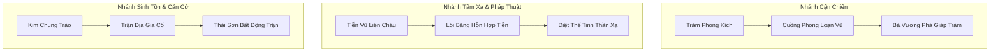
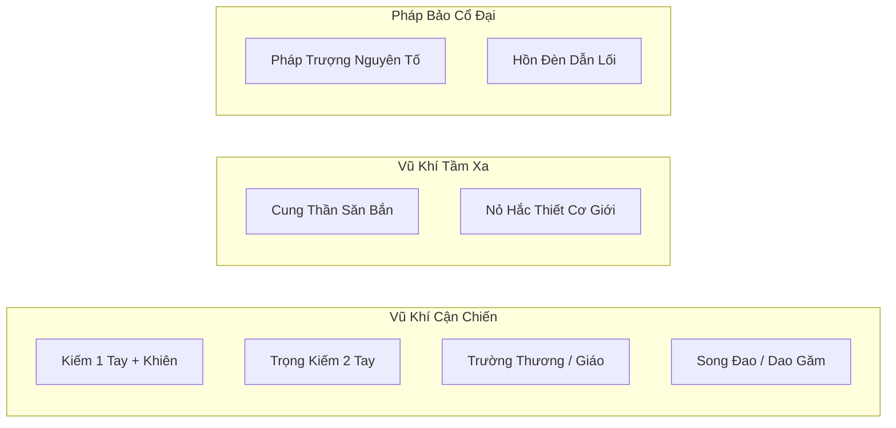

# HỆ THỐNG CƠ SỞ DỮ LIỆU GAME (GAME DATABASE & MECHANICS SPECS)
# DỰ ÁN: LAM TINH – HOANG CỔ KÝ

---

## PHẦN 1: BẢNG DANH MỤC THIÊN PHÚ TOÀN DIỆN (TALENT TREE F -> SSS)

Thiên phú được chia thành 6 Hệ chính:
1. **Chiến Đấu (Combat):** Tăng sức công phá, phòng thủ, bạo kích.
2. **Sinh Hoạt & Chế Tác (Life & Crafting):** Tốc độ thu thập, nhân bản nguyên liệu, may mắn rèn đúc.
3. **Sinh Tồn & Thể Chất (Survival & Vitality):** Kháng đói khát, kháng nhiệt độ, tự hồi máu.
4. **Nguyên Tố & Dị Năng (Elemental & Arcane):** Lửa, Băng, Lôi, Độc, Phong.
5. **Không Gian & Thời Gian (Space & Time):** Dịch chuyển, làm chậm, mở rộng túi đồ.
6. **Triệu Hồi & Dị Thú (Beast Master & Summoning):** Thuần phục dã thú, gọi phân thân.

```
THANG BẬC & TỶ LỆ ROLL GỐC:
[F: 45%] -> [D: 25%] -> [C: 15%] -> [B: 8%] -> [A: 4.5%] -> [S: 2%] -> [SSS: 0.5%]
```

| Bậc | Tên Thiên Phú | Hệ | Hiệu Ứng Chi Tiết | Lối Chơi / Chiến Thuật |
| :--- | :--- | :--- | :--- | :--- |
| **F** | **Cửu Vạn Lực Lưỡng** | Sinh Hoạt | Tải trọng mang vác tối đa +15 kg; chặt cây tốn ít hơn 10% thể lực. | Chuyên làm phu đốn củi, khuân vác đá giai đoạn đầu. |
| **F** | **Cường Tráng Cơ Bắp** | Sinh Tồn | Máu tối đa (Max HP) +30; kháng rét nhẹ (+1°C ngưỡng chịu lạnh). | Thích hợp cho người mới làm quen, giảm tỷ lệ chết sớm. |
| **F** | **Thợ Săn Nghiệp Dư** | Chiến Đấu | Sát thương cung tên lên thú nhỏ (thỏ, gà rừng) +20%. | Săn mồi kiếm thức ăn nhanh hơn trong 3 ngày đầu. |
| **D** | **Thiết Bì Thể Chất** | Sinh Tồn | Giáp vật lý cơ bản +10; giảm 15% sát thương vết cắn từ dã thú. | Build tank sơ cấp, đứng vững trước thú triều đêm 8. |
| **D** | **Luyện Kim Nhập Môn** | Chế Tác | Khi nấu quặng sắt/đồng, có 15% cơ hội nhận thêm 1 thỏi miễn phí. | Tiết kiệm than và quặng thô, tối ưu kinh tế. |
| **D** | **Lạc Bộ Như Phi** | Sinh Hoạt | Tốc độ chạy nhanh (Sprint) +12%; tiêu hao thể lực khi chạy giảm 15%. | Thám hiểm bản đồ, chạy trốn quái ban đêm cực tốt. |
| **C** | **Khát Máu Trảm Sát** | Chiến Đấu | Mỗi khi hạ gục 1 quái vật, hồi ngay 5% Máu tối đa và nhận 5 giây tăng tốc. | Đánh bầy quái nhỏ trong thú triều không lo cạn máu. |
| **C** | **Hỏa Chủng Thân Hòa** | Nguyên Tố | Miễn nhiễm bỏng lửa; đứng cạnh lửa trại hồi máu nhanh gấp 3 lần. | Khắc phục hoàn toàn cái rét ban đêm, giữ ấm dễ dàng. |
| **C** | **Ngư Phu Kỳ Tài** | Sinh Hoạt | Tốc độ cắn câu +50%; 20% câu được cá biến dị tăng vĩnh viễn thuộc tính. | Sinh tồn bằng đường sông nước, chế biến thức ăn cao cấp. |
| **B** | **Tâm Linh Ngự Thú** | Triệu Hồi | Có thể thuần hóa 1 dã thú hoang dã (Chó sói/Báo) thành pet chiến đấu vĩnh viễn. | Người chơi solo có thêm đồng đội gánh sát thương. |
| **B** | **Xảo Đoạt Thiên Công** | Chế Tác | Mọi trang bị tự chế tạo có tỷ lệ nhảy phẩm cấp (từ Trắng lên Lục/Lam) tăng +25%. | Thợ rèn của nhóm hoặc làm giàu từ sàn giao dịch. |
| **B** | **Hàn Băng Thể Phách** | Nguyên Tố | Đòn đánh làm chậm quái 30%; miễn nhiễm hoàn toàn trạng thái Hạ Thân Nhiệt. | Thoải mái thám hiểm ban đêm và vùng tuyết vĩnh cửu. |
| **A** | **Bất Diệt Chiến Ý** | Chiến Đấu | Khi Máu dưới 25%, kích hoạt Khiên Bất Tử trong 4 giây (Hồi chiêu: 1 đêm). | Cứu mạng ngoạn mục trước những cú vồ chí mạng của Boss. |
| **A** | **Thấu Thị Địa Mạch** | Không Gian | Nhìn thấy mạch quặng quý và rương kho báu ngầm xuyên qua lòng đất trong 30m. | Máy dò kim loại sống, giàu tài nguyên thần tốc. |
| **A** | **Cổ Thụ Hộ Mệnh** | Dị Năng | Tường căn cứ xung quanh người chơi nhận thêm 35% giáp và tự phản 20% sát thương. | Thủ lĩnh phòng ngự, giữ vững pháo đài trước thú triều lớn. |
| **S** | **Lôi Đình Cuồng Nộ** | Nguyên Tố | Mọi đòn đánh đều kèm theo tia sét giật lan 4 mục tiêu, gây choáng 1 giây. | Quét sạch quái bầy đàn trong tích tắc. |
| **S** | **Thời Không Lược Ảnh** | Thời Gian | Lướt né chiêu tạo ra một vùng làm chậm 80% mọi quái vật trong 3 giây. | Thao túng cục diện chiến trường, né đòn tuyệt đối. |
| **S** | **Thần Nông Dược Điển** | Sinh Hoạt | Trồng trọt dược liệu thu hoạch ngay sau 1 giờ; chế tạo độc dược/thần dược cực hạn. | Cung ứng thuốc cứu mạng và tăng lực cho cả server. |
| **SSS** | **Hư Không Động Thiên** | Không Gian | Sở hữu Động Phủ Hư Không mang theo người: Kho đồ vô hạn dung tích, có thể bước vào trong để trốn thú triều. | Build huyền thoại, không bao giờ lo mất đồ khi thám hiểm. |
| **SSS** | **Thái Cổ Thần Hoàng Quyết**| Chiến Đấu | Chết sẽ lập tức tái sinh tại chỗ với 100% Máu và phóng ra sóng lửa hủy diệt toàn màn hình (1 lần/mùa). | Đảo ngược quy luật Permadeath, vị thế tuyệt đối trên BXH. |
| **SSS** | **Khởi Nguyên Tạo Vật** | Chế Tác | Có thể phân giải và tái tạo bất kỳ vật chất nào; chế đồ bỏ qua tỷ lệ thất bại, 100% đạt Thần Thoại. | Nắm giữ nền kinh tế tối cao của toàn server. |

---

## PHẦN 2: BẢNG NÚT ĐIỀU KHIỂN & CƠ CHẾ COMBAT (CONTROLS & ACTION)

Game thiết kế trên góc nhìn **Top-Down 2D / 2.5D Isometric**, combat hành động thời gian thực (Action RPG) đề cao phản xạ, căn khoảng cách (hitbox/hurtbox) và quản lý thanh Thể Lực (Stamina).

### 2.1. Sơ Đồ Phím Bấm PC (Chuột & Bàn Phím)

```
[ W, A, S, D ] --------> Di chuyển 8 hướng
[ Chuột Trái (LMB) ] ---> Đòn đánh thường (Light Attack) / Nhấp liên hoàn = Combo 3 nhịp
[ Đè Chuột Trái ] ------> Tụ Lực Trảm (Heavy / Charged Attack) - Uy lực cực mạnh, phá giáp
[ Chuột Phải (RMB) ] ---> Giơ Khiên Chặn Đòn (Block) / Nhấp đúng thời điểm = Phản Đòn (Parry)
[ SPACEBAR ] -----------> Lướt né (Dash / Dodge Roll) - Có 0.25s Khung hình Bất Tử (I-Frames)
[ Q ] ------------------> Kỹ năng Vũ khí 1 (Weapon Skill 1)
[ E ] ------------------> Kỹ năng Vũ khí 2 (Weapon Skill 2)
[ R ] ------------------> Tuyệt Kỹ Tối Thượng (Ultimate / Dị Năng Thiên Phú)
[ F ] ------------------> Tương tác (Nhặt đồ, Chặt/Cuốc, Mở cửa, Bật công tắc bẫy)
[ 1, 2, 3, 4 ] ---------> Dùng nhanh bình máu, thức ăn, đuốc lửa, bùa hộ mệnh
[ TAB ] ----------------> Bật/Tắt Bảng Điều Khiển Sinh Tồn (Kho đồ, Chế tạo, Sàn giao dịch)
[ B ] ------------------> Chế độ Xây Dựng & Sửa Chữa Căn Cứ (Building / Repair Mode)
[ SHIFT ] (Giữ) --------> Chạy nước rút (Sprint) - Tiêu hao 10 Stamina/giây
```

### 2.2. Cơ Chế Chiến Đấu Chuyên Sâu
1. **Combo Đòn Đánh Thường (Combo 3 Nhịp):**
   * Nhịp 1: Chém ngang (quét góc 90° trước mặt, cản bước quái).
   * Nhịp 2: Đâm thẳng (tầm xa hơn, gây đẩy lùi nhẹ).
   * Nhịp 3: Chém bổ xuống (sát thương x2, gây choáng 0.5s nếu quái mất thăng bằng).
2. **Đòn Đánh Tụ Lực (Charged Attack):**
   * Đè giữ chuột trái trong 1.2 giây để nạp thanh năng lượng.
   * Tiêu hao 30 Stamina, gây sát thương cực lớn và **phá vỡ thế thủ (Poise Break)** của quái to/boss.
3. **Chặn & Phản Đòn Hoàn Hảo (Parry System):**
   * Giơ khiên thông thường (RMB): Giảm 70% sát thương nhận vào, mất Stamina theo lực đòn quái.
   * **Parry (Nhấp RMB đúng 0.15s trước khi quái chạm vào người):** Không mất máu, không mất Stamina, khiến quái vật bị khựng đơ trong 2 giây (Mở ra cơ hội tung đòn Kết Liễu Chí Mạng - Critical Execution).
4. **Lướt Né Tránh (Dodge Roll):**
   * Nhấn `SPACE` kết hợp phím hướng để lộn người né tránh.
   * Có **I-Frames (Khung hình bất tử)** giúp né hoàn toàn tia laser của boss hoặc cú quét đuôi của dị thú.

---

## PHẦN 3: HỆ THỐNG KỸ NĂNG (SKILL TREE)

Kỹ năng chia làm 3 nhánh: **Nhánh Vũ Khí Cận Chiến**, **Nhánh Tầm Xa & Pháp Thuật**, **Nhánh Sinh Tồn & Phòng Thủ**.



### 3.1. Danh Sách Chiêu Thức Tiêu Biểu:
* **[Q] Trảm Phong Kích (Cận Chiến):** Vung vũ khí tạo luồng sóng khí bay xa 6m, cắt qua toàn bộ quái vật trên đường thẳng, gây hiệu ứng Chảy Máu.
* **[E] Cuồng Nộ Chấn Địa (Búa/Trọng Kiếm):** Nện mạnh vũ khí xuống mặt đất, tạo chấn động nứt đất trong bán kính 4m, hất văng quái nhỏ và làm choáng quái to 2 giây.
* **[Q] Tiễn Vũ Liên Châu (Cung Tên):** Bắn liền 5 mũi tên hình nón, làm chậm 40% tốc chạy của thú triều trong 3 giây.
* **[E] Phân Thân Huyễn Ảnh (Dao Găm/Song Đao):** Để lại 1 hình nhân rơm thu hút quái vật, bản thân tàng hình lướt ra sau lưng mục tiêu (+100% tỷ lệ bạo kích đòn tiếp theo).
* **[R] Tuyệt Kỹ: Thái Sơn Bất Động Trận (Toàn Năng):** Cắm đại kiếm/trượng xuống đất, tạo vòng bảo hộ đường kính 8m quanh căn cứ: Mọi đồng minh bên trong được hồi 10% máu/giây, tường thành trong vòng nhận 0 sát thương trong 6 giây.

---

## PHẦN 4: DANH MỤC TÀI NGUYÊN (RESOURCE CATALOG)

Tài nguyên trong thế giới Hoang Cổ được phân thành 5 nhóm lớn:

```
[1. Lâm Sản & Gỗ] --- [2. Thạch & Khoáng Sản] --- [3. Dị Thú & Săn Bắn]
           \                    |                    /
            [4. Nông Dược Thảo] - [5. Linh Tinh Năng Lượng]
```

### 4.1. Lâm Sản & Gỗ (Wood & Flora)
1. **Gỗ Thông Thường (Normal Wood):** Chặt từ cây rừng quanh nhà. Dùng nấu nướng, dựng lều gỗ Tier 1.
2. **Gỗ Cứng Thiết Mộc (Ironwood):** Thân cây ánh xám đen, xuất hiện ở Rừng Già. Dùng làm khung nhà Tier 2, cán vũ khí cứng.
3. **Gỗ Huyết Đàn (Blood Wood):** Vỏ cây màu đỏ như máu, chỉ có ở Đầm Lầy Quái Dị. Kháng mục nát, tự hồi phục.
4. **Gỗ Lôi Kích Thần Mộc (Lightning Wood):** Cây cổ thụ cháy đen ngọn trên đỉnh núi sấm sét. Chứa điện tích tự nhiên.
5. **Gỗ Trầm Hương Ngàn Năm:** Thơm ngát, đốt lên làm dịu thú tính của quái ban đêm, nguyên liệu làm bùa chú.

### 4.2. Thạch & Khoáng Sản (Stone & Minerals)
1. **Đá Cuội / Đá Hộc (Cobblestone):** Nhặt bờ suối, đập đá ven đường. Xây lò sưởi, rìu đá sơ cấp.
2. **Quặng Sắt Thô (Raw Iron):** Đào từ mỏ sắt lộ thiên. Đem nung chảy thành Thỏi Sắt (Iron Ingot) rèn vũ khí.
3. **Đá Cương Nham (Granite):** Đá hoa cương cứng cáp ở vùng cao nguyên. Dùng xây tường thành chống quái húc.
4. **Hắc Nham (Obsidian):** Đá thủy tinh núi lửa đen bóng. Chịu nhiệt độ cực cao, rèn dao găm cực sắc bén.
5. **Hắc Thiết Tinh (Dark Iron):** Kim loại nặng sâu dưới đáy hang động phó bản. Kháng ma thuật và chịu lực khủng khiếp.
6. **Bạch Ngân Khoáng (Silver Ore):** Kim loại quý diệt quỷ, rèn vũ khí gây sát thương cực lớn lên quái bóng đêm.
7. **Kim Cương Nham (Diamond Core):** Khoáng thạch cứng nhất, chỉ tìm thấy ở vách đá tổ của quái cấp Boss.

### 4.3. Dị Thú & Săn Bắn (Monster Parts)
1. **Da Thú Hoang / Lông Thú Tuyết:** May quần áo giữ ấm thân nhiệt, làm đệm lót giáp.
2. **Gân Dã Thú Cổ Đại:** Độ đàn hồi siêu hạng, dùng làm dây cung thần hoặc dây co giãn cho bẫy cọc.
3. **Nanh Sói / Răng Nanh Thú Biến Dị:** Gắn vào chông gai hàng rào, tăng sát thương xé rách da quái vật.
4. **Túi Nọc Độc (Venom Sac):** Rơi từ nhện và trăn đầm lầy. Bôi lên vũ khí hoặc chế tên độc.
5. **Lõi Tinh Hạch Quái Vật (Beast Core):** Năng lượng cô đọng trong tim dị thú. Dùng làm pin chạy tháp canh tự động.

### 4.4. Nông Dược Thảo & Lương Thực (Food & Herbs)
1. **Quả Mọng Rừng (Berries):** Cứu đói khát tức thời, ăn nhiều có thể gây đau bụng nếu hái phải quả độc.
2. **Nấm Dạ Quang (Glow Mushroom):** Phát sáng trong đêm, ăn vào tăng tầm nhìn trong bóng tối thêm 50%.
3. **Huyết Linh Chi:** Thảo dược quý mọc trên xác dã thú lâu năm, sắc thuốc hồi phục 80% HP ngay lập tức.
4. **Bạc Hà Giải Nhiệt:** Nhai sống giúp hạ thân nhiệt khi đi qua sa mạc nắng gắt.
5. **Ớt Lửa Hỏa Diệm:** Nấu súp thịt cay giúp giữ ấm cơ thể trong 6 giờ ban đêm.

---

## PHẦN 5: HỆ THỐNG PHẨM CẤP VẬT PHẨM (ITEM RARITY & STAT MULTIPLIER)

Mỗi vật phẩm trong game đều tuân theo bảng màu và quy chuẩn hệ số:

| Phẩm Cấp (Tier) | Mã Màu Hiển Thị | Tỷ Lệ Cơ Bản | Hệ Số Thuộc Tính (Multiplier) | Số Dòng Thuộc Tính Ẩn (Affixes) |
| :--- | :--- | :--- | :--- | :--- |
| **Phàm Phẩm (Common)** | ⚪ Trắng xám (`#B0B0B0`) | 60% | **x 1.0** (Chỉ số cơ bản) | 0 dòng phụ |
| **Tinh Xảo (Uncommon)** | 🟢 Xanh lục (`#2ECC71`) | 25% | **x 1.3** | 1 dòng phụ ngẫu nhiên |
| **Trân Quý (Rare)** | 🔵 Xanh lam (`#3498DB`) | 10% | **x 1.8** | 2 dòng phụ ngẫu nhiên |
| **Cực Phẩm (Epic)** | 🟣 Tím ngọc (`#9B59B6`) | 4% | **x 2.5** | 3 dòng phụ + 1 nội tại vũ khí |
| **Huyền Thoại (Legendary)** | 🟠 Vàng cam (`#E67E22`) | 0.9% | **x 4.0** | 4 dòng phụ + 1 kỹ năng chủ động kích hoạt |
| **Thần Thoại (Mythic)** | 🔴 Đỏ thẫm (`#E74C3C`) | 0.1% | **x 6.5** | 5 dòng tối đa + hiệu ứng biến đổi hình thái |

### Các Dòng Thuộc Tính Ẩn (Affixes Pool):
* `+X% Sát thương bạo kích` / `+X% Tỉ lệ hút máu khi chém quái`
* `+X Kháng lạnh / Kháng say nắng` / `-X% Tiêu hao thể lực`
* `Tự phục hồi độ bền vũ khí dưới ánh trăng`
* `Gây choáng khi đánh trúng điểm yếu`

---

## PHẦN 6: DANH MỤC TRANG BỊ & VŨ KHÍ (WEAPON ARSENAL)



| Loại Vũ Khí | Tốc Độ Đánh | Tầm Đánh | Tiêu Hao Stamina | Đặc Điểm Chiến Thuật Độc Nhất |
| :--- | :--- | :--- | :--- | :--- |
| **Kiếm 1 Tay & Khiên** | Vừa (1.2 đòn/s) | Gần (1.8m) | Thấp (8/đòn) | Công thủ toàn diện; chặn đòn parry làm choáng quái; cực kỳ an toàn cho người mới. |
| **Trọng Kiếm (Greatsword)** | Chậm (0.6 đòn/s) | Rộng (2.8m) | Cao (22/đòn) | Sát thương diện rộng quét tan đàn thú; chém tụ lực phá vỡ giáp quái to; không thể cầm khiên. |
| **Trường Thương (Spear)** | Nhanh (1.5 đòn/s) | Xa nhất cận chiến (3.5m) | Vừa (12/đòn) | Giữ khoảng cách cực tốt; đâm xuyên qua hàng rào căn cứ để diệt quái bên ngoài mà không sợ bị cắn. |
| **Song Đao (Dual Daggers)** | Siêu nhanh (2.5 đòn/s) | Rất gần (1.2m) | Rất thấp (5/đòn) | Tốc độ chém điên cuồng, kích hoạt hiệu ứng Chảy Máu và Độc tố nhanh gấp 3 lần; né đòn lướt cực xa. |
| **Cung Săn Bắn (Bow)** | Tùy nhịp kéo dây | Xa (15 – 25m) | 15/mũi tên | Tấn công an toàn từ trên tháp canh nhà gỗ; có thể bắn tên lửa xua quái hoặc tên băng làm chậm. |
| **Nỏ Cơ Giới (Crossbow)** | Nạp đạn chậm, bắn tức thì | Cực xa (30m) | 0 (tốn thời gian nạp) | Sát thương đơn mục tiêu cực khủng, độ chính xác tuyệt đối; vũ khí bắn tỉa hạ sát quái tinh anh. |
| **Pháp Trượng Nguyên Tố** | Theo nhịp niệm phép | Tầm trung (12m) | Tốn Mana/Linh lực | Gọi bão lửa, phóng lôi đình quét sạch thú triều trước cổng căn cứ. |

---

## PHẦN 7: CÁC LOẠI ĐỒ TIÊU HAO & CÔNG CỤ SINH HOẠT (TOOLS & CONSUMABLES)

### 7.1. Bộ Công Cụ Sinh Tồn Bắt Buộc (Tools)
1. **Rìu Đốn Củi (Axe):** Đá $\rightarrow$ Sắt $\rightarrow$ Thép Tôi $\rightarrow$ Hắc Thiết $\rightarrow$ Lôi Kích Mộc. Tăng tốc độ đốn cây và sát thương hệ mộc.
2. **Cuốc Khai Khoáng (Pickaxe):** Đập vỡ các khối đá, đào quặng sắt, hắc nham. Cuốc cấp cao mới đào được khoáng sản quý.
3. **Cần Câu Trúc / Cần Câu Gân Thú (Fishing Rod):** Câu cá ở ao hồ, đầm lầy, tìm kiếm bảo vật chìm dưới lòng sông.
4. **Búa Sửa Chữa (Repair Hammer):** Công cụ tối thượng để bảo trì nhà cửa, gõ vào tường nứt vỡ để hồi phục độ bền trong đêm thú triều.
5. **Xẻng Xới Đất (Shovel):** Đào đất làm hào chông quanh nhà, xới đất làm luống gieo trồng thảo dược.

### 7.2. Vật Phẩm Tiêu Hao Sinh Tồn (Consumables)
* **Băng Gạc Rừng:** Chế từ cỏ khô và tơ nhện. Cầm máu lập tức, hồi 50 HP sau 5 giây.
* **Thịt Nướng Lửa Trại:** Hồi 35 điểm Đói, tăng 10% thể lực tối đa trong 10 phút.
* **Thịt Sống (Cấm ăn sống):** Ăn vào có 80% nguy cơ trúng độc và sán, giảm 50% thanh đói và tụt máu.
* **Bình Nước Da Thú:** Chứa được 3 ngụm nước sạch. Cứu nguy khi đi qua vùng khô hạn.
* **Đuốc Nhựa Cây (Torch):** Cung cấp ánh sáng trong bán kính 5 ô, xua đuổi các loài dã thú sợ lửa cấp thấp, giữ ấm +1.5°C.
* **Phù Chú Hồi Căn Cứ (Town Portal Scroll):** Vật phẩm hiếm từ rương phó bản, niệm chú 5 giây để dịch chuyển tức thời về lại Giường Ngủ trong nhà gỗ khi gặp nguy hiểm cận tử.
