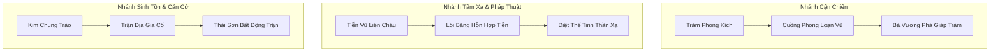
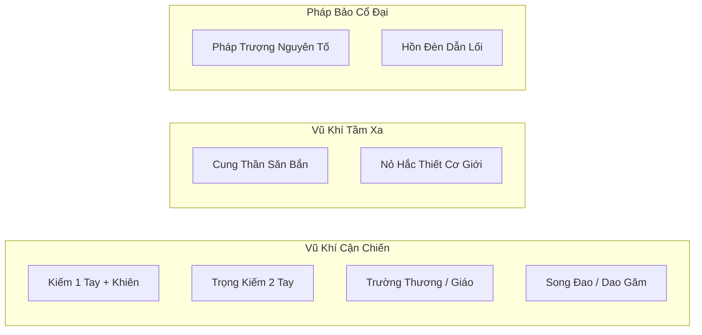

# HỆ THỐNG CƠ SỞ DỮ LIỆU GAME (GAME DATABASE & MECHANICS SPECS)
# DỰ ÁN: LAM TINH – HOANG CỔ KÝ

---

## PHẦN 1: BẢNG DANH MỤC THIÊN PHÚ TOÀN DIỆN (TALENT TREE F -> SSS)

### 1.1. Quy Luật Phân Phối Tỷ Lệ Nghịch (Inverse Pyramid Distribution)
Theo thiết lập thế giới Lam Tinh Xuyên Không:
* **Bậc càng thấp (F, D, C):** Số lượng chủng loại thiên phú **càng nhiều và cực kỳ đa dạng** (chiếm số đông quần chúng, phản ánh các đặc điểm nghề nghiệp, thói quen sinh hoạt ở Lam Tinh mang sang).
* **Bậc càng cao (A, S, SSS):** Số lượng chủng loại thiên phú **càng ít và độc bản** (hàng hiếm có khó tìm, mang tính quy tắc và định hình toàn bộ meta server).

```
KIM TỰ THÁP THIÊN PHÚ (SỐ LƯỢNG TỶ LỆ NGHỊCH VỚI BẬC):
   [ SSS:  2 Thiên phú ]      <--- Độc bản tối thượng, xoay chuyển càn khôn (0.5%)
    [ S:   3 Thiên phú ]      <--- Thao túng quy tắc thế giới (2.0%)
     [ A:  5 Thiên phú ]      <--- Cột trụ chiến thuật và phòng ngự (4.5%)
      [ B: 8 Thiên phú ]      <--- Chuyên môn hóa sâu, thuần thú & chế tác (8.0%)
      [ C: 12 Thiên phú ]     <--- Kỹ năng sinh tồn & chiến đấu thực chiến (15.0%)
     [ D:  18 Thiên phú ]     <--- Bổ trợ sinh hoạt & khai khoáng sơ cấp (25.0%)
    [ F:   25 Thiên phú ]     <--- Quần chúng Lam Tinh, muôn hình vạn trạng (45.0%)
```

---

### 1.2. Danh Mục Chi Tiết 73 Thiên Phú

#### 🟢 BẬC F (25 Thiên Phú - Phổ Thông Nhất, Nghề Nghiệp & Thói Quen Lam Tinh)
| STT | Tên Thiên Phú | Hệ | Hiệu Ứng Chi Tiết | Lối Chơi Điển Hình |
| :---: | :--- | :--- | :--- | :--- |
| 1 | **Cửu Vạn Lực Lưỡng** | Sinh Hoạt | Tải trọng balo +15 kg; chặt cây tốn ít hơn 10% thể lực. | Phu đốn củi, khuân vác tài nguyên. |
| 2 | **Cường Tráng Cơ Bắp** | Sinh Tồn | Máu tối đa (Max HP) +30; tăng 1°C ngưỡng chịu rét. | Tân thủ cứng cáp, giảm tỷ lệ chết sớm. |
| 3 | **Thợ Săn Nghiệp Dư** | Chiến Đấu | Sát thương cung tên lên thú nhỏ (thỏ, chim rừng) +25%. | Kiếm thức ăn nhanh trong 3 ngày đầu. |
| 4 | **Túi Dạ Dày Bò** | Sinh Tồn | Thanh đói giảm chậm hơn 15%; ăn thức ăn thô ít bị đau bụng. | Thích hợp cho người lười tìm thức ăn. |
| 5 | **Mọt Sách Trí Nhớ** | Chế Tác | Nhận thêm 10% điểm kinh nghiệm khi chế tạo vật phẩm. | Nhanh mở khóa công thức đồ đạc mới. |
| 6 | **Dân Chạy Shipper** | Sinh Hoạt | Tiêu hao thể lực khi chạy bộ giảm 15%. | Thám hiểm mở bản đồ, chạy trốn dã thú. |
| 7 | **Bàn Tay Khéo Léo** | Chế Tác | Tốc độ đan dây leo, làm giỏ mây, đóng hòm nhanh hơn 30%. | Xây dựng căn cứ sơ khai tốc độ cao. |
| 8 | **Thính Giác Nhạy Bén** | Sinh Tồn | Nghe thấy tiếng bước chân quái vật từ khoảng cách xa hơn 8m. | Tránh bị phục kích trong sương mù đêm. |
| 9 | **Cần Thủ Kiên Trì** | Sinh Hoạt | Tỷ lệ cá cắn câu tăng 20%; giảm nguy cơ đứt dây câu. | Kiếm nguồn đạm dồi dào ven sông. |
| 10 | **Dân Văn Phòng Trầm Lặng**| Sinh Tồn | Tốc độ tích tụ căng thẳng giảm; ngồi nghỉ hồi thể lực nhanh hơn 20%. | Hồi sức nhanh giữa các đợt lao động. |
| 11 | **Thợ Điện Đãng Trí** | Chế Tác | Tăng 10% sát thương từ bẫy cơ quan tự chế tạo. | Đặt bẫy chông quanh nhà gỗ. |
| 12 | **Đôi Mắt Tinh Anh** | Sinh Hoạt | Dễ phát hiện tổ ong, quả mọng ẩn trong bụi rậm hơn 25%. | Tìm kiếm thực phẩm dồi dào đầu game. |
| 13 | **Chân Bơi Rái Cá** | Sinh Hoạt | Tốc độ bơi dưới nước +25%; giảm tiêu hao oxi 20%. | Vượt sông, khai thác tài nguyên lòng suối. |
| 14 | **Làn Da Dày Dạn** | Sinh Tồn | Giảm 10% sát thương từ gai góc cào rách khi chui qua bụi rậm. | Thu thập thảo dược trong rừng gai. |
| 15 | **Bác Sĩ Thực Tập** | Sinh Tồn | Băng gạc và thảo dược hồi phục thêm 15% lượng máu. | Tự hồi phục tiết kiệm thuốc men. |
| 16 | **Kẻ Nhặt Rác May Mắn**| Sinh Hoạt | 10% cơ hội nhặt thêm 1 cành củi/đá cuội khi thu lượm trên mặt đất. | Tích tiểu thành đại ở giai đoạn trắng tay. |
| 17 | **Hơi Thở Sâu Dài** | Sinh Tồn | Thanh thể lực tối đa +15 điểm. | Thao tác vung rìu/cuốc được nhiều nhịp hơn. |
| 18 | **Kháng Độc Nhẹ** | Sinh Tồn | Thời gian trúng độc từ bọ cắn giảm 20%. | Đỡ nguy hiểm khi lỡ hái nấm dại. |
| 19 | **Đầu Bếp Gia Đình** | Sinh Hoạt | Thức ăn nướng trên lửa trại giữ ấm cơ thể thêm 10 phút. | Kháng rét cho bản thân và đồng đội. |
| 20 | **Thói Quen Tiết Kiệm**| Sinh Hoạt | Đuốc cháy lâu hơn 25% trước khi tàn lụi. | Tiết kiệm nhựa cây và gỗ vào ban đêm. |
| 21 | **Lạc Quan Yêu Đời** | Tâm Trí | Tốc độ hồi máu tự nhiên khi đứng cạnh đồng minh tăng 15%. | Thích hợp chơi nhóm, hỗ trợ tinh thần. |
| 22 | **Cú Vung Rìu Dứt Khoát**| Chiến Đấu| Sát thương rìu đốn củi lên quái vật tăng 15%. | Dùng rìu làm vũ khí phòng thân tạm thời. |
| 23 | **Thói Quen Ngủ Sớm** | Sinh Tồn | Ngủ trên giường nhà gỗ hồi phục đầy thanh máu nhanh hơn 25%. | Mau chóng lấy lại phong độ sau khi bị thương. |
| 24 | **Khứu Giác Động Vật** | Sinh Tồn | Phát hiện mùi thịt thối hoặc nguồn nước ngọt trong bán kính 15m. | Sinh tồn vùng hoang mạc thiếu nước. |
| 25 | **Người Chịu Nóng** | Sinh Tồn | Ngưỡng chịu sốc nhiệt tăng thêm +1.5°C khi trời nắng gắt. | Hoạt động tốt giữa trưa nắng. |

---

#### 🟡 BẬC D (18 Thiên Phú - Kỹ Năng Bổ Trợ Sơ Cấp & Bắt Đầu Định Hình Hướng Đi)
| STT | Tên Thiên Phú | Hệ | Hiệu Ứng Chi Tiết | Lối Chơi Điển Hình |
| :---: | :--- | :--- | :--- | :--- |
| 1 | **Thiết Bì Thể Chất** | Sinh Tồn | Giáp vật lý cơ bản +10; giảm 15% sát thương từ vết cắn dã thú. | Build đỡ đòn sơ khai, đứng chặn cửa nhà. |
| 2 | **Luyện Kim Nhập Môn** | Chế Tác | Khi nung quặng sắt/đồng, 15% cơ hội nhận thêm 1 thỏi miễn phí. | Tiết kiệm khoáng sản quý giá. |
| 3 | **Lạc Bộ Như Phi** | Sinh Hoạt | Tốc độ chạy nước rút (Sprint) +12%; tiêu hao thể lực giảm 15%. | Di chuyển liên vùng, né thú triều cơ động. |
| 4 | **Tiều Phu Lão Luyện** | Sinh Hoạt | Chặt cây gây x2 sát thương lên thân mộc; 10% rơi gỗ lõi chất lượng. | Khai thác gỗ làm nhà kiên cố cực nhanh. |
| 5 | **Thợ Mỏ Cần Mẫn** | Sinh Hoạt | Tốc độ đập đá +25%; giảm 20% tỷ lệ mẻ cuốc khai khoáng. | Cung cấp đá và sắt thỏi cho liên minh. |
| 6 | **Bách Bộ Xuyên Dương Sơ Cấp**| Chiến Đấu| Tầm bắn cung tên +3m; tốc độ giương cung nhanh hơn 15%. | Xạ thủ trên tháp canh nhà gỗ. |
| 7 | **Hộ Vệ Khiên Gỗ** | Chiến Đấu | Chặn đòn bằng khiên giảm thêm 15% sát thương lọt qua. | Chống chịu các cú tát trời giáng của gấu. |
| 8 | **Gia Cố Công Trình Sơ Cấp**| Chế Tác | Tường rào do người này dựng nhận thêm 20% độ bền tối đa. | Thợ xây căn cứ, tăng sức bền phòng tuyến. |
| 9 | **Dã Ngoại Sinh Tồn Giả** | Sinh Tồn | Kháng cả nóng và lạnh +1°C; uống nước suối tự nhiên không đau bụng. | Thám hiểm độc hành không cần chuẩn bị nhiều. |
| 10 | **Huyết Khí Tráng Kiện** | Sinh Tồn | Khi máu dưới 30%, tự động hồi máu từ từ lên mức 30% mà không tốn thuốc. | Giữ mạng sống sót qua những thời khắc hiểm nghèo. |
| 11 | **Bẫy Rập Chuyên Gia** | Chiến Đấu | Sát thương bẫy chông +30%; bẫy có 25% cơ hội không bị hỏng sau khi nổ. | Dựng bãi mìn chông quanh căn cứ. |
| 12 | **Đả Kích Chí Mạng** | Chiến Đấu | Tỷ lệ bạo kích đòn đánh thường +8%. | Sát thủ dồn sát thương quái tinh anh. |
| 13 | **Chiết Xuất Thảo Dược** | Chế Tác | Chế tạo bình thuốc tăng 20% dược tính hồi phục. | Dược sư sơ cấp, buôn bán thuốc trên sàn. |
| 14 | **Đầu Bếp Hoang Dã** | Sinh Hoạt | Món ăn chế biến tăng thêm 25% chỉ số độ no và buff thể lực. | Hậu cần nuôi sống đội nhóm vượt qua đêm lạnh. |
| 15 | **Bàn Tay Nhặt Khoáng**| Sinh Hoạt | Khi đào đá có 8% đào trúng đá quý/tinh thể thô. | Tích lũy phụ gia cho chế tạo đồ lam. |
| 16 | **Thuần Dưỡng Tiểu Thú**| Triệu Hồi | Có thể cho thú nhỏ (chồn, cáo) ăn để chúng nhặt cành cây/quả về nhà. | Thú nuôi tự động lượm tài nguyên quanh căn cứ. |
| 17 | **Chiến Ý Sục Sôi** | Chiến Đấu | Sau khi hạ 1 quái, đòn đánh kế tiếp tăng 25% sát thương trong 3 giây. | Đánh chuỗi quét quái nhỏ liên tục. |
| 18 | **Giác Quan Nguy Hiểm** | Sinh Tồn | Bản đồ nhỏ phát tín hiệu nhấp nháy đỏ khi có quái vật tiếp cận trong 20m. | Cảnh báo sớm trước các cuộc đột kích ban đêm. |

---

#### 🔵 BẬC C (12 Thiên Phú - Kỹ Năng Thực Chiến & Sinh Tồn Chuyên Biệt)
| STT | Tên Thiên Phú | Hệ | Hiệu Ứng Chi Tiết | Lối Chơi Điển Hình |
| :---: | :--- | :--- | :--- | :--- |
| 1 | **Khát Máu Trảm Sát** | Chiến Đấu | Mỗi khi hạ 1 quái vật, hồi 5% Max HP và nhận 5 giây tăng 20% tốc độ chạy. | Đồ sát bầy quái thú triều không lo cạn máu. |
| 2 | **Hỏa Chủng Thân Hòa** | Nguyên Tố | Miễn nhiễm bỏng lửa; đứng cạnh lửa trại hồi máu x3 lần; vũ khí có xác suất bốc cháy. | Khắc chế màn đêm buốt giá, cận chiến hệ hỏa. |
| 3 | **Ngư Phu Kỳ Tài** | Sinh Hoạt | Tốc độ cắn câu +50%; 20% câu được cá biến dị tăng vĩnh viễn thuộc tính nhỏ. | Câu cá kiếm bảo vật và tăng tiến sức mạnh lâu dài. |
| 4 | **Thiết Giáp Cương Thân** | Chiến Đấu | Giảm 20% sát thương đòn đánh trực diện; kháng hiệu ứng choáng nhẹ. | Đứng trước cổng thành chắn quái húc. |
| 5 | **Linh Xảo Lách Đòn** | Chiến Đấu | Lướt né chiêu (Dash) hồi lại nhanh hơn 30%; tiêu hao thể lực giảm 25%. | Lối đánh cơ động, né chiêu boss không tốn sức. |
| 6 | **Cường Hóa Cung Thủ** | Chiến Đấu | Mũi tên bắn ra có 25% cơ hội xuyên qua 2 mục tiêu liên tiếp. | Tiêu diệt quái theo hàng dọc trước cổng rào. |
| 7 | **Hàn Khí Ngưng Tụ** | Nguyên Tố | Đòn đánh thường làm chậm 20% tốc chạy của quái; chịu lạnh ban đêm cực tốt. | Thả diều quái to, làm chậm bước tiến thú triều. |
| 8 | **Thợ Rèn Đột Phá** | Chế Tác | Khi chế tạo trang bị, 20% nhảy từ phẩm chất Trắng lên Lục hoặc Lục lên Lam. | Sản xuất trang bị chất lượng cao kiếm lời. |
| 9 | **Bậc Thầy Bẫy Rập** | Chế Tác | Quái đạp trúng bẫy bị trói chân 3 giây và chịu thêm 40% sát thương từ người chơi. | Giữ chân quái tinh anh để đồng đội dồn sát thương. |
| 10 | **Tầm Nhìn Dạ Xoa** | Sinh Tồn | Tầm nhìn trong bóng tối ban đêm tăng gấp đôi (từ 15% lên 30%); không sợ sương mù. | Đi săn đêm kiếm tài nguyên phó bản hiếm. |
| 11 | **Hấp Thụ Độc Tố** | Sinh Tồn | Miễn nhiễm 70% độc nhện/rắn; khi trúng độc tự chuyển hóa thành thể lực. | Chinh phục đầm lầy tử khí dễ như dạo chơi. |
| 12 | **Khí Công Hộ Thể** | Thể Chất | Tạo một lớp màng hấp thụ 100 sát thương mỗi 60 giây khi rời giao tranh. | Lá chắn tự hồi phục, tiết kiệm dược liệu tối đa. |

---

#### 🟣 BẬC B (8 Thiên Phú - Chuyên Môn Hóa Đột Phá, Khác Biệt Rõ Nét)
| STT | Tên Thiên Phú | Hệ | Hiệu Ứng Chi Tiết | Lối Chơi Điển Hình |
| :---: | :--- | :--- | :--- | :--- |
| 1 | **Tâm Linh Ngự Thú** | Triệu Hồi | Thuần hóa 1 dã thú hoang dã (Sói/Báo/Gấu) thành pet chiến đấu trung thành vĩnh viễn. | Tăng hỏa lực, có thú cưng gánh đòn cho chủ. |
| 2 | **Xảo Đoạt Thiên Công** | Chế Tác | Mọi trang bị chế tạo có tỷ lệ nhảy phẩm cấp tăng +25%; giảm 20% nguyên liệu rèn. | Thợ rèn huyền thoại của bang hội. |
| 3 | **Hàn Băng Thể Phách** | Nguyên Tố | Đòn đánh đóng băng quái 1.5 giây; miễn nhiễm hoàn toàn trạng thái Hạ Thân Nhiệt. | Bất tử trước mùa đông và cái rét ban đêm. |
| 4 | **Cuồng Phong Trảm Kích**| Chiến Đấu | Tốc độ đánh cận chiến +30%; đòn thứ 4 tung ra lốc xoáy hất tung quái nhỏ. | Đồ tể bão đao, xé nát bầy quái áp sát. |
| 5 | **Kim Thạch Thần Thông** | Sinh Hoạt | Đào mỏ luôn rớt x2 quặng; có thể đào được quặng Tier 3 mà không cần cuốc cao cấp. | Thống trị nguồn cung kim loại toàn server. |
| 6 | **Pháo Đài Trưởng** | Dị Năng | Khi đứng trong phạm vi căn cứ: Bản thân nhận +30% công/thủ; tường thành tự hồi 0.5% máu/phút. | Trùm thủ nhà, pháo đài bất khả xâm phạm. |
| 7 | **Huyết Tế Cuồng Nộ** | Chiến Đấu | Máu càng tụt, sát thương càng tăng (mỗi 10% máu mất = +8% sát thương, tối đa +64%). | Đánh liều mạng, lật kèo boss trong gang tấc. |
| 8 | **Linh Dược Đan Sư** | Chế Tác | Tự sáng tạo các loại đan dược biến dị: Thuốc tăng lực, thuốc tàng hình, thuốc giải độc vạn năng. | Nhà giả kim tối thượng, nắm huyết mạch kinh tế thuốc. |

---

#### 🔴 BẬC A (5 Thiên Phú - Cột Trụ Đội Nhóm & Thay Đổi Chiến Cục)
| STT | Tên Thiên Phú | Hệ | Hiệu Ứng Chi Tiết | Lối Chơi Điển Hình |
| :---: | :--- | :--- | :--- | :--- |
| 1 | **Bất Diệt Chiến Ý** | Chiến Đấu | Khi Máu dưới 20%, lập tức kích hoạt Khiên Bất Tử trong 4 giây và hồi 30% Máu (Hồi chiêu: 1 chu kỳ đêm). | Cứu mạng tuyệt đối trước những pha One-hit của Boss. |
| 2 | **Thấu Thị Địa Mạch** | Không Gian | Nhìn thấy mạch quặng quý, hang động ngầm và rương cổ xuyên qua lòng đất trong 30m. | Máy dò kho báu sống, dẫn đội săn phó bản. |
| 3 | **Cổ Thụ Hộ Mệnh** | Dị Năng | Tường căn cứ xung quanh nhận thêm 40% giáp; tự động bắn chông gai phản lại 25% sát thương khi bị quái húc. | Hạt nhân phòng ngự của liên minh trước thú triều lớn. |
| 4 | **Cuồng Lôi Trừng Phạt** | Nguyên Tố | Mỗi đòn đánh tích 1 tầng sấm sét; đủ 5 tầng giáng thiên lôi thiêu đốt diện rộng gây choáng 2 giây. | Sát thương diện rộng hủy diệt đàn quái tinh anh. |
| 5 | **Vạn Thú Chi Hữu** | Triệu Hồi | Dã thú hoang dã cấp thường không chủ động tấn công người chơi; có thể thuần hóa tối đa 3 chiến thú cùng lúc. | Quân đoàn thú chiến, một người quét sạch phó bản. |

---

#### 🟠 BẬC S (3 Thiên Phú - Thao Túng Quy Tắc Thế Giới, Siêu Cấp Hiếm)
| STT | Tên Thiên Phú | Hệ | Hiệu Ứng Chi Tiết | Lối Chơi Điển Hình |
| :---: | :--- | :--- | :--- | :--- |
| 1 | **Lôi Đình Thần Phạt** | Nguyên Tố | Mọi đòn đánh đều kèm theo sấm sét giật lan 5 mục tiêu; có thể gọi bão sét đánh sập các hang ổ quái vật từ xa. | Hỏa lực thần thánh quét sạch toàn bộ thú triều. |
| 2 | **Thời Không Lược Ảnh** | Thời Gian | Lướt né tạo vùng ngưng đọng thời gian làm chậm 90% quái vật trong 4 giây; hồi chiêu kỹ năng giảm 50%. | Bất tử trong giao tranh, điều khiển nhịp độ trận đánh theo ý muốn. |
| 3 | **Thần Nông Dược Điển** | Sinh Hoạt | Trồng thảo dược thu hoạch chỉ sau 30 phút; chế tạo Thần Đan ban phát buff vĩnh viễn cho bản thân và đồng đội. | Dược vương cứu rỗi cả server, định giá kinh tế toàn bộ dị giới. |

---

#### 🌟 BẬC SSS (2 Thiên Phú Độc Bản Tối Thượng - Nghịch Thiên Cải Mệnh, Chấn Động Toàn Server)
| STT | Tên Thiên Phú | Hệ | Hiệu Ứng Chi Tiết | Lối Chơi Điển Hình |
| :---: | :--- | :--- | :--- | :--- |
| 1 | **Hư Không Động Thiên** | Không Gian | **Sở hữu Động Phủ Không Gian Riêng:** Balo không đáy (vô hạn dung tích và tải trọng); có thể mở cổng bước hẳn vào trong động phủ để trú ẩn, né tránh hoàn toàn bất kỳ đợt thú triều hay boss nào ngoài thế giới thực. | Tự do tuyệt đối, mang theo cả gia tài bên mình mà không sợ rủi ro mất đồ khi tử trận. |
| 2 | **Thái Cổ Thần Hoàng Quyết**| Chiến Đấu & Tái Sinh | **Nghịch Chuyển Sinh Tử:** Khi nhân vật tử trận, lập tức niết bàn hồi sinh tại chỗ với 100% HP, tạo ra sóng lửa Phượng Hoàng thiêu rụi toàn bộ quái vật trên màn hình (Miễn trừ cơ chế Permadeath 1 lần mỗi mùa giải). | Vị thế tối cao, bất tử trước quy luật nghiệt ngã của Hoang Cổ Giới. |

---

---

## PHẦN 2: BẢNG NÚT ĐIỀU KHIỂN & CƠ CHẾ COMBAT (CONTROLS & ACTION)

Game thiết kế trên góc nhìn **Top-Down 2D / 2.5D Isometric**, combat hành động thời gian thực (Action RPG) đề cao phản xạ, căn khoảng cách (hitbox/hurtbox) và quản lý thanh Thể Lực (Stamina).

### 2.1. Sơ Đồ Phím Bấm PC (Chuột & Bàn Phím)

```
[ W, A, S, D ] --------> Di chuyển 8 hướng
[ Chuột Trái (LMB) ] ---> Đòn đánh thường (Light Attack) / Nhấp liên hoàn = Combo 3 nhịp
[ Đè Chuột Trái ] ------> Tụ Lực Trảm (Heavy / Charged Attack) - Uy lực cực mạnh, phá giáp
[ Chuột Phải (RMB) ] ---> Giơ Khiên Chặn Đòn (Block) / Nhấp đúng thời điểm = Phản Đòn (Parry)
[ SPACEBAR ] -----------> Lướt né (Dash / Dodge Roll) - Có 0.25s Khung hình Bất Tử (I-Frames)
[ Q ] ------------------> Kỹ năng Vũ khí 1 (Weapon Skill 1)
[ E ] ------------------> Kỹ năng Vũ khí 2 (Weapon Skill 2)
[ R ] ------------------> Tuyệt Kỹ Tối Thượng (Ultimate / Dị Năng Thiên Phú)
[ F ] ------------------> Tương tác (Nhặt đồ, Chặt/Cuốc, Mở cửa, Bật công tắc bẫy)
[ 1, 2, 3, 4 ] ---------> Dùng nhanh bình máu, thức ăn, đuốc lửa, bùa hộ mệnh
[ TAB ] ----------------> Bật/Tắt Bảng Điều Khiển Sinh Tồn (Kho đồ, Chế tạo, Sàn giao dịch)
[ B ] ------------------> Chế độ Xây Dựng & Sửa Chữa Căn Cứ (Building / Repair Mode)
[ SHIFT ] (Giữ) --------> Chạy nước rút (Sprint) - Tiêu hao 10 Stamina/giây
```

### 2.2. Cơ Chế Chiến Đấu Chuyên Sâu
1. **Combo Đòn Đánh Thường (Combo 3 Nhịp):**
   * Nhịp 1: Chém ngang (quét góc 90° trước mặt, cản bước quái).
   * Nhịp 2: Đâm thẳng (tầm xa hơn, gây đẩy lùi nhẹ).
   * Nhịp 3: Chém bổ xuống (sát thương x2, gây choáng 0.5s nếu quái mất thăng bằng).
2. **Đòn Đánh Tụ Lực (Charged Attack):**
   * Đè giữ chuột trái trong 1.2 giây để nạp thanh năng lượng.
   * Tiêu hao 30 Stamina, gây sát thương cực lớn và **phá vỡ thế thủ (Poise Break)** của quái to/boss.
3. **Chặn & Phản Đòn Hoàn Hảo (Parry System):**
   * Giơ khiên thông thường (RMB): Giảm 70% sát thương nhận vào, mất Stamina theo lực đòn quái.
   * **Parry (Nhấp RMB đúng 0.15s trước khi quái chạm vào người):** Không mất máu, không mất Stamina, khiến quái vật bị khựng đơ trong 2 giây (Mở ra cơ hội tung đòn Kết Liễu Chí Mạng - Critical Execution).
4. **Lướt Né Tránh (Dodge Roll):**
   * Nhấn `SPACE` kết hợp phím hướng để lộn người né tránh.
   * Có **I-Frames (Khung hình bất tử)** giúp né hoàn toàn tia laser của boss hoặc cú quét đuôi của dị thú.

---

## PHẦN 3: HỆ THỐNG KỸ NĂNG (SKILL TREE)

Kỹ năng chia làm 3 nhánh: **Nhánh Vũ Khí Cận Chiến**, **Nhánh Tầm Xa & Pháp Thuật**, **Nhánh Sinh Tồn & Phòng Thủ**.



### 3.1. Danh Sách Chiêu Thức Tiêu Biểu:
* **[Q] Trảm Phong Kích (Cận Chiến):** Vung vũ khí tạo luồng sóng khí bay xa 6m, cắt qua toàn bộ quái vật trên đường thẳng, gây hiệu ứng Chảy Máu.
* **[E] Cuồng Nộ Chấn Địa (Búa/Trọng Kiếm):** Nện mạnh vũ khí xuống mặt đất, tạo chấn động nứt đất trong bán kính 4m, hất văng quái nhỏ và làm choáng quái to 2 giây.
* **[Q] Tiễn Vũ Liên Châu (Cung Tên):** Bắn liền 5 mũi tên hình nón, làm chậm 40% tốc chạy của thú triều trong 3 giây.
* **[E] Phân Thân Huyễn Ảnh (Dao Găm/Song Đao):** Để lại 1 hình nhân rơm thu hút quái vật, bản thân tàng hình lướt ra sau lưng mục tiêu (+100% tỷ lệ bạo kích đòn tiếp theo).
* **[R] Tuyệt Kỹ: Thái Sơn Bất Động Trận (Toàn Năng):** Cắm đại kiếm/trượng xuống đất, tạo vòng bảo hộ đường kính 8m quanh căn cứ: Mọi đồng minh bên trong được hồi 10% máu/giây, tường thành trong vòng nhận 0 sát thương trong 6 giây.

---

## PHẦN 4: DANH MỤC TÀI NGUYÊN (RESOURCE CATALOG)

Tài nguyên trong thế giới Hoang Cổ được phân thành 5 nhóm lớn:

```
[1. Lâm Sản & Gỗ] --- [2. Thạch & Khoáng Sản] --- [3. Dị Thú & Săn Bắn]
           \                    |                    /
            [4. Nông Dược Thảo] - [5. Linh Tinh Năng Lượng]
```

### 4.1. Lâm Sản & Gỗ (Wood & Flora)
1. **Gỗ Thông Thường (Normal Wood):** Chặt từ cây rừng quanh nhà. Dùng nấu nướng, dựng lều gỗ Tier 1.
2. **Gỗ Cứng Thiết Mộc (Ironwood):** Thân cây ánh xám đen, xuất hiện ở Rừng Già. Dùng làm khung nhà Tier 2, cán vũ khí cứng.
3. **Gỗ Huyết Đàn (Blood Wood):** Vỏ cây màu đỏ như máu, chỉ có ở Đầm Lầy Quái Dị. Kháng mục nát, tự hồi phục.
4. **Gỗ Lôi Kích Thần Mộc (Lightning Wood):** Cây cổ thụ cháy đen ngọn trên đỉnh núi sấm sét. Chứa điện tích tự nhiên.
5. **Gỗ Trầm Hương Ngàn Năm:** Thơm ngát, đốt lên làm dịu thú tính của quái ban đêm, nguyên liệu làm bùa chú.

### 4.2. Thạch & Khoáng Sản (Stone & Minerals)
1. **Đá Cuội / Đá Hộc (Cobblestone):** Nhặt bờ suối, đập đá ven đường. Xây lò sưởi, rìu đá sơ cấp.
2. **Quặng Sắt Thô (Raw Iron):** Đào từ mỏ sắt lộ thiên. Đem nung chảy thành Thỏi Sắt (Iron Ingot) rèn vũ khí.
3. **Đá Cương Nham (Granite):** Đá hoa cương cứng cáp ở vùng cao nguyên. Dùng xây tường thành chống quái húc.
4. **Hắc Nham (Obsidian):** Đá thủy tinh núi lửa đen bóng. Chịu nhiệt độ cực cao, rèn dao găm cực sắc bén.
5. **Hắc Thiết Tinh (Dark Iron):** Kim loại nặng sâu dưới đáy hang động phó bản. Kháng ma thuật và chịu lực khủng khiếp.
6. **Bạch Ngân Khoáng (Silver Ore):** Kim loại quý diệt quỷ, rèn vũ khí gây sát thương cực lớn lên quái bóng đêm.
7. **Kim Cương Nham (Diamond Core):** Khoáng thạch cứng nhất, chỉ tìm thấy ở vách đá tổ của quái cấp Boss.

### 4.3. Dị Thú & Săn Bắn (Monster Parts)
1. **Da Thú Hoang / Lông Thú Tuyết:** May quần áo giữ ấm thân nhiệt, làm đệm lót giáp.
2. **Gân Dã Thú Cổ Đại:** Độ đàn hồi siêu hạng, dùng làm dây cung thần hoặc dây co giãn cho bẫy cọc.
3. **Nanh Sói / Răng Nanh Thú Biến Dị:** Gắn vào chông gai hàng rào, tăng sát thương xé rách da quái vật.
4. **Túi Nọc Độc (Venom Sac):** Rơi từ nhện và trăn đầm lầy. Bôi lên vũ khí hoặc chế tên độc.
5. **Lõi Tinh Hạch Quái Vật (Beast Core):** Năng lượng cô đọng trong tim dị thú. Dùng làm pin chạy tháp canh tự động.

### 4.4. Nông Dược Thảo & Lương Thực (Food & Herbs)
1. **Quả Mọng Rừng (Berries):** Cứu đói khát tức thời, ăn nhiều có thể gây đau bụng nếu hái phải quả độc.
2. **Nấm Dạ Quang (Glow Mushroom):** Phát sáng trong đêm, ăn vào tăng tầm nhìn trong bóng tối thêm 50%.
3. **Huyết Linh Chi:** Thảo dược quý mọc trên xác dã thú lâu năm, sắc thuốc hồi phục 80% HP ngay lập tức.
4. **Bạc Hà Giải Nhiệt:** Nhai sống giúp hạ thân nhiệt khi đi qua sa mạc nắng gắt.
5. **Ớt Lửa Hỏa Diệm:** Nấu súp thịt cay giúp giữ ấm cơ thể trong 6 giờ ban đêm.

---

## PHẦN 5: HỆ THỐNG PHẨM CẤP VẬT PHẨM (ITEM RARITY & STAT MULTIPLIER)

Mỗi vật phẩm trong game đều tuân theo bảng màu và quy chuẩn hệ số:

| Phẩm Cấp (Tier) | Mã Màu Hiển Thị | Tỷ Lệ Cơ Bản | Hệ Số Thuộc Tính (Multiplier) | Số Dòng Thuộc Tính Ẩn (Affixes) |
| :--- | :--- | :--- | :--- | :--- |
| **Phàm Phẩm (Common)** | ⚪ Trắng xám (`#B0B0B0`) | 60% | **x 1.0** (Chỉ số cơ bản) | 0 dòng phụ |
| **Tinh Xảo (Uncommon)** | 🟢 Xanh lục (`#2ECC71`) | 25% | **x 1.3** | 1 dòng phụ ngẫu nhiên |
| **Trân Quý (Rare)** | 🔵 Xanh lam (`#3498DB`) | 10% | **x 1.8** | 2 dòng phụ ngẫu nhiên |
| **Cực Phẩm (Epic)** | 🟣 Tím ngọc (`#9B59B6`) | 4% | **x 2.5** | 3 dòng phụ + 1 nội tại vũ khí |
| **Huyền Thoại (Legendary)** | 🟠 Vàng cam (`#E67E22`) | 0.9% | **x 4.0** | 4 dòng phụ + 1 kỹ năng chủ động kích hoạt |
| **Thần Thoại (Mythic)** | 🔴 Đỏ thẫm (`#E74C3C`) | 0.1% | **x 6.5** | 5 dòng tối đa + hiệu ứng biến đổi hình thái |

### Các Dòng Thuộc Tính Ẩn (Affixes Pool):
* `+X% Sát thương bạo kích` / `+X% Tỉ lệ hút máu khi chém quái`
* `+X Kháng lạnh / Kháng say nắng` / `-X% Tiêu hao thể lực`
* `Tự phục hồi độ bền vũ khí dưới ánh trăng`
* `Gây choáng khi đánh trúng điểm yếu`

---

## PHẦN 6: DANH MỤC TRANG BỊ & VŨ KHÍ (WEAPON ARSENAL)



| Loại Vũ Khí | Tốc Độ Đánh | Tầm Đánh | Tiêu Hao Stamina | Đặc Điểm Chiến Thuật Độc Nhất |
| :--- | :--- | :--- | :--- | :--- |
| **Kiếm 1 Tay & Khiên** | Vừa (1.2 đòn/s) | Gần (1.8m) | Thấp (8/đòn) | Công thủ toàn diện; chặn đòn parry làm choáng quái; cực kỳ an toàn cho người mới. |
| **Trọng Kiếm (Greatsword)** | Chậm (0.6 đòn/s) | Rộng (2.8m) | Cao (22/đòn) | Sát thương diện rộng quét tan đàn thú; chém tụ lực phá vỡ giáp quái to; không thể cầm khiên. |
| **Trường Thương (Spear)** | Nhanh (1.5 đòn/s) | Xa nhất cận chiến (3.5m) | Vừa (12/đòn) | Giữ khoảng cách cực tốt; đâm xuyên qua hàng rào căn cứ để diệt quái bên ngoài mà không sợ bị cắn. |
| **Song Đao (Dual Daggers)** | Siêu nhanh (2.5 đòn/s) | Rất gần (1.2m) | Rất thấp (5/đòn) | Tốc độ chém điên cuồng, kích hoạt hiệu ứng Chảy Máu và Độc tố nhanh gấp 3 lần; né đòn lướt cực xa. |
| **Cung Săn Bắn (Bow)** | Tùy nhịp kéo dây | Xa (15 – 25m) | 15/mũi tên | Tấn công an toàn từ trên tháp canh nhà gỗ; có thể bắn tên lửa xua quái hoặc tên băng làm chậm. |
| **Nỏ Cơ Giới (Crossbow)** | Nạp đạn chậm, bắn tức thì | Cực xa (30m) | 0 (tốn thời gian nạp) | Sát thương đơn mục tiêu cực khủng, độ chính xác tuyệt đối; vũ khí bắn tỉa hạ sát quái tinh anh. |
| **Pháp Trượng Nguyên Tố** | Theo nhịp niệm phép | Tầm trung (12m) | Tốn Mana/Linh lực | Gọi bão lửa, phóng lôi đình quét sạch thú triều trước cổng căn cứ. |

---

## PHẦN 7: CÁC LOẠI ĐỒ TIÊU HAO & CÔNG CỤ SINH HOẠT (TOOLS & CONSUMABLES)

### 7.1. Bộ Công Cụ Sinh Tồn Bắt Buộc (Tools)
1. **Rìu Đốn Củi (Axe):** Đá $\rightarrow$ Sắt $\rightarrow$ Thép Tôi $\rightarrow$ Hắc Thiết $\rightarrow$ Lôi Kích Mộc. Tăng tốc độ đốn cây và sát thương hệ mộc.
2. **Cuốc Khai Khoáng (Pickaxe):** Đập vỡ các khối đá, đào quặng sắt, hắc nham. Cuốc cấp cao mới đào được khoáng sản quý.
3. **Cần Câu Trúc / Cần Câu Gân Thú (Fishing Rod):** Câu cá ở ao hồ, đầm lầy, tìm kiếm bảo vật chìm dưới lòng sông.
4. **Búa Sửa Chữa (Repair Hammer):** Công cụ tối thượng để bảo trì nhà cửa, gõ vào tường nứt vỡ để hồi phục độ bền trong đêm thú triều.
5. **Xẻng Xới Đất (Shovel):** Đào đất làm hào chông quanh nhà, xới đất làm luống gieo trồng thảo dược.

### 7.2. Vật Phẩm Tiêu Hao Sinh Tồn (Consumables)
* **Băng Gạc Rừng:** Chế từ cỏ khô và tơ nhện. Cầm máu lập tức, hồi 50 HP sau 5 giây.
* **Thịt Nướng Lửa Trại:** Hồi 35 điểm Đói, tăng 10% thể lực tối đa trong 10 phút.
* **Thịt Sống (Cấm ăn sống):** Ăn vào có 80% nguy cơ trúng độc và sán, giảm 50% thanh đói và tụt máu.
* **Bình Nước Da Thú:** Chứa được 3 ngụm nước sạch. Cứu nguy khi đi qua vùng khô hạn.
* **Đuốc Nhựa Cây (Torch):** Cung cấp ánh sáng trong bán kính 5 ô, xua đuổi các loài dã thú sợ lửa cấp thấp, giữ ấm +1.5°C.
* **Phù Chú Hồi Căn Cứ (Town Portal Scroll):** Vật phẩm hiếm từ rương phó bản, niệm chú 5 giây để dịch chuyển tức thời về lại Giường Ngủ trong nhà gỗ khi gặp nguy hiểm cận tử.
