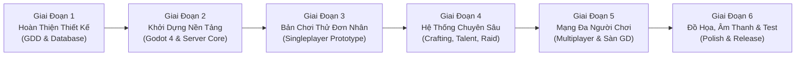

# KẾ HOẠCH TRIỂN KHAI DỰ ÁN (MASTER DEVELOPMENT ROADMAP)
# DỰ ÁN: LAM TINH – HOANG CỔ KÝ

---

## 🎯 MỤC TIÊU TỔNG QUAN
Xây dựng trò chơi **2D Top-Down Sinh Tồn Xuyên Không & Thủ Thành Đa Người Chơi (Multiplayer Survival & Base Defense RPG)** từ giai đoạn thiết kế ý tưởng đến sản phẩm chơi được (Playable MVP) và phát hành thử nghiệm.

---

## 🗺️ LỘ TRÌNH 6 GIAI ĐOẠN CHI TIẾT (6 PHASES)

---

### GIAI ĐOẠN 1: HOÀN THIỆN THIẾT KẾ & TÀI LIỆU CỐT LÕI (DESIGN SPECIFICATIONS)
*Trọng tâm: Xác định tường minh mọi thông số để lập trình không bị mơ hồ.*
* [x] **1.1.** Game Design Document tổng thể (`docs/GDD_Hoang_Co_Ky.md`) *(Đã xong)*.
* [x] **1.2.** Cơ sở dữ liệu 73 Thiên Phú kim tự tháp, Hệ thống phím Combat, 5 Nhóm tài nguyên, 7 dòng vũ khí (`docs/DATABASE_HE_THONG_VAT_PHAM_KY_NANG.md`) *(Đã xong)*.
* [ ] **1.3. Bảng Dị Thú & Thú Triều (Bestiary & Raid Design):**
  * Danh mục quái vật theo ngày (Ngày 1–7 quái lẻ, Ngày 8–15 bầy sói bọc giáp, Ngày 16–30 nhện axít & quái bay).
  * 4 Con Boss chu kỳ đêm (Tê Giác Thiết Giáp, Xà Vương Đầm Lầy, Ưng Cổ Đại, Cự Nhân Hắc Nham).
  * Hành vi AI công thành (ưu tiên đánh cột nhà, tường hay người chơi).
* [ ] **1.4. Bảng Công Thức Chế Tạo & Công Trình Phòng Thủ:**
  * Bảng tỷ lệ phối trộn nguyên liệu (Gỗ/Đá/Sắt) cho từng loại vũ khí.
  * Thông số các loại bẫy: Bẫy chông, Hào lửa, Tháp nỏ tự động, Màng chắn ma pháp.
* [ ] **1.5. Hệ Thống Nhiệm Vụ & Cốt Truyện Lam Tinh (Quest & Lore):**
  * Chuỗi nhiệm vụ tân thủ 7 ngày đầu.
  * NPC bí ẩn (Tàn hồn người xưa, Thương nhân lang thang dị giới).

---

### GIAI ĐOẠN 2: KHỞI TẠO NỀN TẢNG KỸ THUẬT (TECH SKELETON SETUP)
*Trọng tâm: Dựng khung sườn dự án chuẩn kiến trúc Client - Server.*
* [ ] **2.1. Cấu trúc Dự Án Godot 4 (Client 2D):**
  * Khởi tạo project Godot 4.x hỗ trợ Pixel Art / 2D Top-Down.
  * Cài đặt Input Map (WASD, Chuột trái combo, Chuột phải Parry, Space né, Q, E, R, TAB, B).
  * Thiết lập CanvasModulate (hệ thống ánh sáng chu kỳ Ngày/Đêm) và Camera2D mượt mà.
* [ ] **2.2. Khởi tạo Dedicated Server (Authoritative Server):**
  * Chọn ngôn ngữ backend: **Golang** (ưu tiên tốc độ phát triển và concurrency tuyệt vời) hoặc **Rust** hoặc **Godot Headless**.
  * Cài đặt giao thức mạng: ENet/UDP cho di chuyển/chiến đấu, WebSocket cho Chat & Sàn giao dịch.
* [ ] **2.3. Thiết Lập Cơ Sở Dữ Liệu:**
  * Script khởi tạo PostgreSQL (Bảng Accounts, Players, Bases, Inventories, Market_Orders).
  * Cấu hình Redis (Cache vị trí, Leaderboard SP realtime).

---

### GIAI ĐOẠN 3: BẢN PROTOTYPE CHƠI ĐƯỢC ĐẦU TIÊN (CORE LOOP PROTOTYPE)
*Trọng tâm: Trải nghiệm được vòng lặp cơ bản: Đốn củi $\rightarrow$ Xây nhà $\rightarrow$ Thủ thú triều đêm 1.*
* [ ] **3.1. Nhân Vật & Điều Khiển:**
  * Di chuyển 8 hướng, hoạt ảnh Idle, Run, Attack.
  * Thanh trạng thái: Máu (HP), Thể lực (Stamina), Đói, Khát, Thân nhiệt.
* [ ] **3.2. Thu Thập Tài Nguyên:**
  * Tương tác cây (đốn củi) và đá (đập khoáng) có hiệu ứng rung lắc và rơi đồ.
  * Nhặt đồ vào Kho đồ thông minh (Inventory UI).
* [ ] **3.3. Xây Dựng Căn Cứ & Độ Bền:**
  * Đặt các block tường gỗ, cửa gỗ, lửa trại.
  * Cơ chế trừ máu công trình khi bị đánh và cơ chế dùng búa sửa chữa.
* [ ] **3.4. Chu Kỳ Ngày/Đêm & Đợt Thú Triều Thử Nghiệm:**
  * Ánh sáng giảm dần từ chiều sang tối; nhiệt độ hạ thấp.
  * Xuất hiện đợt thú triều 5–10 con sói chạy tới cắn phá tường gỗ.

---

### GIAI ĐOẠN 4: HOÀN THIỆN CÁC CƠ CHẾ SÂU (DEEP SURVIVAL MECHANICS)
*Trọng tâm: Đưa toàn bộ các điểm sáng tạo của GDD vào game.*
* [ ] **4.1. Hệ Thống Chế Tạo Tổ Hợp (Synergy Workbench):**
  * Giao diện Bàn Chế Tạo cho phép kéo thả tỷ lệ % Gỗ, Đá, Sắt.
  * Thuật toán tính toán phẩm cấp (Trắng $\rightarrow$ Lục $\rightarrow$ Lam $\rightarrow$ Tím).
* [ ] **4.2. Hệ Thống Thiên Phú & Ngộ Đạo Hành Động:**
  * Thuật toán roll 1 trong 73 thiên phú khi tạo nhân vật.
  * Bộ đếm hành động (chặt 300 cây kích hoạt kỹ năng ẩn *Nhất Phủ Đoạn Mộc*).
* [ ] **4.3. Động Lực Học Môi Trường Hoàn Chỉnh:**
  * Cơ chế sốc nhiệt (Say nắng khi nắng to, Cóng buốt mất máu khi đêm rét nếu không có lửa).
* [ ] **4.4. Tiến Hóa Căn Cứ 5 Bậc:**
  * Nâng cấp từ Nhà Gỗ $\rightarrow$ Thành Trì Đá $\rightarrow$ Pháo Đài Hắc Thiết.

---

### GIAI ĐOẠN 5: ĐA NGƯỜI CHƠI & SÀN GIAO DỊCH TOÀN CẦU (MULTIPLAYER & MARKET)
*Trọng tâm: Biến game thành một thế giới sinh tồn liên thông.*
* [ ] **5.1. Đồng Bộ Nhiều Người Chơi:**
  * Server điều phối vị trí, trạng thái của các người chơi trong cùng khu vực.
  * Khắc phục độ trễ và chống hack tốc độ/hack dịch chuyển.
* [ ] **5.2. Sàn Giao Dịch Toàn Cầu (Global Market UI):**
  * Đăng bán vật phẩm (Sell Order) và tạo lệnh mua (Buy Order).
  * Tự động trừ thuế 5% và chuyển vật phẩm vào hòm thư.
* [ ] **5.3. Bảng Xếp Hạng & Hệ Thống Permadeath:**
  * Tổng kết Điểm Sinh Tồn (SP) mỗi rạng đông, phát thưởng hòm đồ.
  * Xử lý giao dịch an toàn khi nhân vật tử trận (xóa nhân vật nhưng giữ kỷ lục tài khoản).

---

### GIAI ĐOẠN 6: ĐỒ HỌA, ÂM THANH & ĐÓNG GÓI SẢN PHẨM (POLISH & LAUNCH)
*Trọng tâm: Nâng cấp trải nghiệm thị giác và thính giác.*
* [ ] **6.1. Visual & Audio Polish:**
  * Thiết kế bộ Sprite 2D đẹp mắt, hiệu ứng đổ bóng ban đêm đáng sợ.
  * Âm thanh gầm rú của thú triều, tiếng chặt cây, tiếng rèn kim loại.
* [ ] **6.2. Cân Bằng Gameplay (Balancing):**
  * Chạy thử nghiệm mô phỏng độ khó từ Ngày 1 đến Ngày 30.
* [ ] **6.3. Đóng Gói Demo:**
  * Build bản Windows/Web/Linux để thử nghiệm cộng đồng.

---

## 📌 BƯỚC ĐI TIẾP THEO NGAY BÂY GIỜ

Chúng ta có 2 ngã rẽ rõ ràng để bắt đầu ngay:

1. **Lựa chọn A (Tiếp tục hoàn thiện nốt Tài liệu Thiết kế chuyên sâu - Phase 1.3 & 1.4):**
   * Thiết kế chi tiết **Bảng Dị Thú & 4 Đại Boss Thú Triều Ban Đêm** (Máu, Giáp, Đòn đánh công thành, Điểm yếu chí mạng, Tỷ lệ rơi đồ).
   * Thiết kế **Công Thức Chế Tạo Tổ Hợp & Danh Mục Bẫy Phòng Thủ Căn Cứ**.

2. **Lựa chọn B (Bắt tay ngay vào Lập trình - Phase 2 & 3):**
   * Khởi tạo cấu trúc dự án **Godot 4.x** (hoặc Backend Go Server) trực tiếp trong thư mục `D:\gameRPG_AI`.
   * Lập trình nhân vật di chuyển 8 hướng, camera, thanh máu/thể lực/thân nhiệt và cơ chế chặt cây/đập đá đầu tiên.
