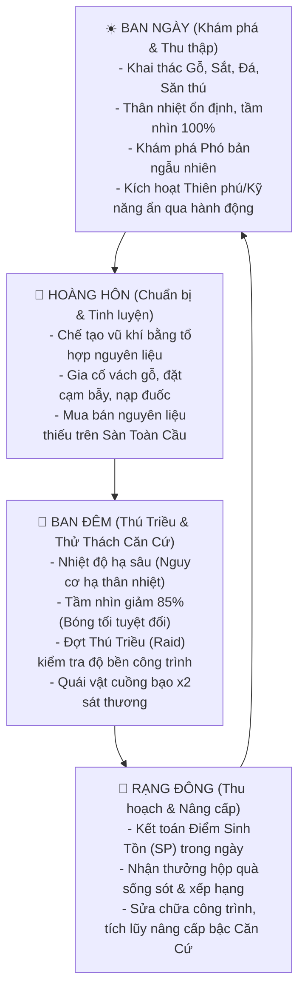
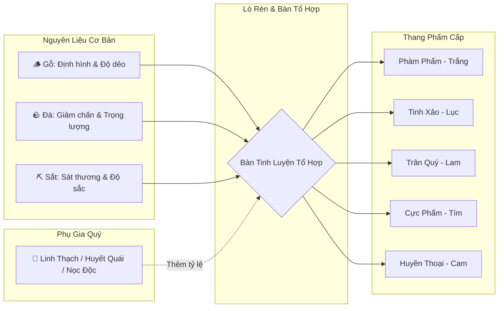

# GAME DESIGN DOCUMENT (GDD)
# DỰ ÁN: LAM TINH – HOANG CỔ KÝ (BLUE STAR: PRIMORDIAL SURVIVAL)

---

## 1. TỔNG QUAN DỰ ÁN & CỐT TRUYỆN KHỞI ĐẦU

### 1.1. Bối cảnh & Cốt truyện (Lore & Setting)
* **Sự Kiện Đại Dịch Chuyển:** Toàn bộ nhân loại trên hành tinh Lam Tinh bị một ý chí vũ trụ tối cao cưỡng chế dịch chuyển vào một thế giới cổ đại hoang vu, huyền bí mang tên **Hoang Cổ Dị Giới**.
* **Khởi đầu trắng tay:** Không máy móc, không điện lưới, không vũ khí nóng. Mỗi người chơi thức tỉnh tại một tọa độ ngẫu nhiên giữa chốn hoang dã mênh mông, chỉ sở hữu:
  * **01 Căn cứ sơ cấp (Nhà gỗ cấp 1)** có màng bảo hộ tân thủ 7 ngày đầu.
  * **01 Rìu đá cũ** & **01 Cuốc đá vỡ** để bắt đầu sinh tồn.
  * **01 Bảng Điều Khiển Sinh Tồn Linh Hồn:** Giao diện cá nhân theo dõi chỉ số, kho đồ, chế tạo và sàn giao dịch toàn cầu.
  * **01 Thiên phú ngẫu nhiên (F đến SSS):** Được thức tỉnh ngay khoảnh khắc đặt chân xuống thế giới mới.
* **Mục tiêu tối thượng:** Khai khoáng, chặt cây, săn bắn, chế tạo vũ khí thông qua việc phối hợp nguyên liệu; nâng cấp căn cứ từ túp lều gỗ ọp ẹp thành pháo đài thép kiên cố; chống lại các đợt thú triều cuồng nộ ban đêm; chinh phục phó bản ngẫu nhiên và leo lên đỉnh Bảng Xếp Hạng Sinh Tồn toàn cầu. Chết là mất nhân vật (Permadeath), bắt đầu lại với lượt chơi mới.

### 1.2. Các Trụ Cột Thiết Kế Cốt Lõi (Core Pillars)
1. **Sinh Tồn Khắc Nghiệt & Động Lực Nhiệt Độ:** Cơ chế đói khát, hạ thân nhiệt ban đêm và say nắng giữa trưa.
2. **Căn Cứ Là Mạng Sống (Base Durability & Raid Check):** Quái vật ban đêm có AI công thành, kiểm tra độ bền từng vách tường, bẫy rào và cột chịu lực.
3. **Chế Tạo Tổ Hợp Nguyên Liệu (Synergy Combination):** Kết hợp Gỗ, Sắt, Đá theo tỷ lệ tối ưu và căn chỉnh nhiệt độ để đạt phẩm cấp cao nhất (Trân quý, Cực phẩm, Thần thoại).
4. **Hành Động Khởi Sinh Kỹ Năng Ẩn (Action-Triggered Talents):** Chặt cây ngộ ra chiêu chém đôi thân mộc, đào khoáng nguy cấp mở khóa mình đồng da sắt, câu cá đêm ngộ thuật thở dưới nước.
5. **Kinh Tế Sàn Giao Dịch Toàn Cầu & Khan Hiếm Địa Lý:** Tài nguyên phân bố theo vùng sinh thái (Biome), buộc người chơi trao đổi qua bảng giao dịch hoặc mạo hiểm vào phó bản.
6. **Multiplayer Authoritative Server:** Đồng bộ thế giới thực, chống hack triệt để (server nắm toàn quyền logic).

---

## 2. VÒNG LẶP GAMEPLAY CHÍNH (CORE GAMEPLAY LOOP)



---

## 3. CƠ CHẾ SINH TỒN, MÔI TRƯỜNG & NHIỆT ĐỘ

### 3.1. Các Chỉ Số Sinh Tồn Cá Nhân
| Chỉ Số | Phạm Vi | Cơ Chế Hoạt Động & Ảnh Hưởng | Biện Pháp Duy Trì / Hồi Phục |
| :--- | :--- | :--- | :--- |
| **HP (Máu)** | 0 – 100% | Máu về 0 dẫn đến chết nhân vật (Permadeath). Mất máu khi bị quái cắn, đói/khát kiệt quệ, rét cóng. | Băng gạc, thảo dược, thức ăn hầm chín, nằm nghỉ trong căn cứ. |
| **Thể Lực (Stamina)** | 0 – 100 | Tiêu hao khi vung rìu/cuốc, né đòn, chạy nước rút. Hồi chậm khi đang đói. | Đứng yên, đi bộ chậm, uống trà thảo mộc. |
| **Cơn Đói (Hunger)** | 0 – 100 | Tụt theo thời gian thực và cường độ chặt cây/đào khoáng. < 20% giảm 30% tốc độ di chuyển; = 0% mất máu liên tục. | Quả mọng, thịt nướng, lương khô tổng hợp. |
| **Cơn Khát (Thirst)** | 0 – 100 | Tụt nhanh hơn khi nhiệt độ môi trường cao. Thiếu nước gây hoa mắt, mờ màn hình. | Nước đun sôi, nước dừa rừng, bình nước mang theo. Nước bẩn có nguy cơ trúng độc. |
| **Thân Nhiệt (Body Temp)** | 32°C – 42°C | **Ngưỡng chuẩn: 36.5°C – 37.2°C.** Lệch chuẩn gây debuff nghiêm trọng. | Lửa trại, áo ấm, bóng râm, thuốc giải nhiệt. |

### 3.2. Cơ Chế Biến Thiên Nhiệt Độ & Tầm Nhìn
* **Hạ Thân Nhiệt (< 35.0°C):**
  * Diễn ra khi màn đêm buông xuống, gặp mưa bão, hoặc bơi qua sông buốt.
  * Nhân vật run rẩy (giảm 30% độ chính xác khi dùng cung/rìu), tốc độ di chuyển giảm 40%. Nếu dưới 32°C, máu rút 2 HP/giây.
  * *Biện pháp:* Đốt đuốc, dựng Lửa trại trong nhà, mặc Áo Lông Thú, uống Rượu Ớt.
* **Quá Nhiệt / Say Nắng (> 38.5°C):**
  * Diễn ra vào chính ngọ tại vùng sa mạc, đất khô cằn, hoặc khi mặc giáp kim loại nặng dưới trời nắng to.
  * Tốc độ tiêu hao nước tăng 300%, thể lực cạn kiệt nhanh gấp đôi.
  * *Biện pháp:* Trú dưới tán cây râm mát, ngâm mình trong hồ nước nông, cởi giáp sắt, uống Nước Bạc Hà.
* **Chu kỳ Tầm nhìn:**
  * **Ngày:** Tầm nhìn toàn cảnh 100%. Quái vật lẩn tránh trong bụi rậm/hang động.
  * **Đêm:** Tầm nhìn thu hẹp về bán kính 3 ô xung quanh nhân vật (Fog of War dày đặc). Nguồn sáng (Đuốc, Lửa trại, Đèn dầu) trở thành trung tâm thu hút hoặc xua đuổi các loài dã thú cổ đại.

---

## 4. TIẾN HÓA CĂN CỨ & HỆ THỐNG THỬ THÁCH ĐỘ BỀN (BASE RAID CHECK)

### 4.1. Lộ Trình Nâng Cấp Căn Cứ & Cây Tiến Hóa Nguyên Liệu Cao Cấp

Để sinh tồn qua các chu kỳ thú triều ngày càng khốc liệt và biến dị, người chơi không thể chỉ dựa vào gỗ và đá thông thường nhặt quanh nhà. Hệ thống nâng cấp căn cứ được phân tầng qua **5 Bậc Nguyên Liệu (Tier 1 đến Tier 5)**, kết hợp giữa 3 trụ cột (Gỗ - Đá - Kim Loại) cùng các vật liệu dị biến và lõi thú cổ đại.

```mermaid
graph TD
    subgraph T1_SoKhai["Tier 1: Sơ Khai (Ngày 1-7)"]
        W1[Gỗ Thông Thường]
        S1[Đá Cuội / Đá Hộc]
        I1[Sắt Rỉ Sơ Cấp]
    end

    subgraph T2_GiaCo["Tier 2: Tinh Luyện & Gia Cố (Ngày 8-15)"]
        W2[Gỗ Thiết Mộc / Gỗ Lim Cổ]
        S2[Đá Hoa Cương / Cương Nham]
        I2[Thép Tôi / Đinh Tán Tinh Luyện]
    end

    subgraph T3_LinhKhoang["Tier 3: Dị Thú & Linh Khoáng (Ngày 16-30)"]
        W3[Gỗ Huyết Đàn / Cổ Thụ Ngàn Năm]
        S3[Hắc Nham / Huyền Vũ Thạch]
        I3[Hắc Thiết Tinh / Bạch Ngân Khoáng]
        C3[Chất Dính: Nhựa Cổ Thụ + Tơ Nhện Chúa]
    end

    subgraph T4_NguyenNang["Tier 4: Cổ Đại & Nguyên Năng (Ngày 31-50)"]
        W4[Gỗ Lôi Kích Thần Mộc]
        S4[Kim Cương Nham / Tinh Thạch Địa Mạch]
        I4[Hợp Kim Huyền Thiết / Huyết Ma Kim]
        C4[Lõi Thú Vương / Trái Tim Dị Biến]
    end

    subgraph T5_ThanThoai["Tier 5: Hư Không & Thần Thoại (Ngày 50+)"]
        W5[Phượng Hoàng Mộc / Cây Thế Giới]
        S5[Bất Diệt Thần Thạch]
        I5[Thần Kim Thái Cổ / Tinh Vụ Thiết]
        C5[Hư Không Tinh Thạch / Trật Tự Bản Nguyên]
    end

    T1_SoKhai -->|Nâng cấp Nhà Gỗ Kiên Cố| T2_GiaCo
    T2_GiaCo -->|Nâng cấp Thành Trì Đá| T3_LinhKhoang
    T3_LinhKhoang -->|Nâng cấp Pháo Đài Hắc Thiết| T4_NguyenNang
    T4_NguyenNang -->|Nâng cấp Cổ Bảo Thần Thoại| T5_ThanThoai
```



#### Chi Tiết 5 Bậc Nguyên Liệu Nâng Cấp Nhà Gỗ:

| Bậc (Tier) | Nguyên Liệu Nâng Cấp Cốt Lõi | Nguồn Gốc Thu Thập | Hiệu Ứng Đặc Trưng Ban Cho Căn Cứ |
| :--- | :--- | :--- | :--- |
| **Tier 1: Sơ Khai** *(Lều Gỗ Tân Thủ)* | • Gỗ Rừng Thường<br>• Đá Cuội Bờ Suối<br>• Dây Leo & Bùn Đất | Chặt cây, đập đá quanh nhà. | • Che mưa nắng cơ bản.<br>• Màng bảo hộ tân thủ 7 ngày đầu. Dễ bắt lửa và bị quái cắn thủng. |
| **Tier 2: Gia Cố** *(Nhà Gỗ Tròn Kiên Cố)* | • **Gỗ Thiết Mộc:** Gỗ đanh cứng như sắt.<br>• **Đá Cương Nham:** Chịu lực va đập.<br>• **Thép Tôi & Đinh Tán:** Gia cố then cửa. | Đốn hạ cây đại thụ trong Rừng Già; Khai thác mỏ đá lộ thiên. | • **Kháng Cháy 40%** (không bị dã thú mang lửa đốt cháy).<br>• Giảm 25% sát thương va đập từ heo rừng bọc giáp. |
| **Tier 3: Linh Khoáng** *(Thành Lũy Đá Kiên Cố)* | • **Gỗ Huyết Đàn:** Cây hút máu thú.<br>• **Hắc Nham (Obsidian):** Đá dung nham nguội.<br>• **Hắc Thiết Tinh:** Kim loại đen sâu trong lòng đất.<br>• **Keo Tơ Nhện Chúa:** Trám khe nứt tường. | Hang động sâu; Phó bản Đầm Lầy; Săn quái Tinh Anh cấp 3. | • **Tự Động Phục Hồi Nhẹ:** Tường tự hồi 1% HP mỗi giờ khi không có giao tranh.<br>• **Kháng Axit 80%:** Dịch độc nhện không làm mục nát kết cấu.<br>• Mở khóa **Tháp Nỏ Bắn Tự Động**. |
| **Tier 4: Nguyên Năng** *(Pháo Đài Hắc Thiết)* | • **Gỗ Lôi Kích Thần Mộc:** Cổ thụ bị sét đánh không cháy mà tích điện.<br>• **Kim Cương Nham:** Cực kỳ rắn chắc.<br>• **Hợp Kim Huyết Ma Kim:** Rèn từ máu boss và sắt đen.<br>• **Lõi Thú Vương:** Nguồn năng lượng vĩnh cửu. | Rương Boss Đêm thứ 30; Phó bản Di Tích Cổ Đại; Mua trên Sàn Toàn Cầu. | • **Phản Sát Thương Điện (Thorns):** Quái thú húc vào tường sẽ bị giật điện tê liệt 1.5 giây.<br>• **Điều Hòa Nhiệt Độ Căn Cứ:** Bên trong nhà luôn giữ mức $36.8^\circ\text{C}$ bất chấp bão tuyết hay nắng gắt.<br>• Mở khóa **Hào Chông Tự Kích Hoạt**. |
| **Tier 5: Thần Thoại** *(Động Phủ / Cổ Bảo Bất Diệt)* | • **Phượng Hoàng Mộc (Cây Hồi Sinh)**<br>• **Bất Diệt Thần Thạch**<br>• **Hư Không Tinh Thạch**<br>• **Trật Tự Bản Nguyên** | Boss Thế Giới (World Boss); Tận cùng Phó Bản Vực Sâu Hư Không; Tái sinh mùa giải. | • **Không Gian Động Phủ Mở Rộng:** Bên ngoài nhìn là nhà gỗ cổ kính, bên trong là không gian đa chiều rộng vô tận.<br>• **Hàng Rào Năng Lượng Thái Cổ:** Chống chịu 100% mọi đợt thú triều thường; chỉ Boss Thế Giới mới có thể tạo áp lực.<br>• Cho phép căn cứ mở **Cổng Dịch Chuyển** liên thông lãnh thổ liên minh. |

### 4.2. Cơ Chế Thử Thách Đợt Thú Triều (Raid Durability Check)
* **Quy luật phát động:** 
  * 7 ngày đầu tân thủ: Không có thú triều phá nhà, chỉ có quái đi lạc rình mò.
  * Từ đêm thứ 8 trở đi: Đúng 00:00 mỗi đêm, còi báo động vang lên, đợt Thú Triều (Raid) ập tới.
* **Cơ chế AI Công Thành (Siege AI):**
  * Quái thú triều nhắm trực tiếp vào **Kết cấu chịu lực** (Cột nhà, Tường rào, Cửa ra vào) để tiến vào Lõi Nhà.
  * *Loài Húc (Heo bọc giáp, Tê giác đá):* Tông thẳng làm nứt vỡ tường gỗ nhanh chóng.
  * *Loài Ăn Mòn (Bọ bùn, Nhện axít):* Làm suy yếu độ bền kết cấu theo thời gian.
  * *Loài Nhảy/Bay (Dơi cổ đại, Báo đen gai):* Nhảy vượt hàng rào để tấn công người chơi đang thủ trên nóc.
* **Độ Bền & Cơ Chế Sửa Chữa:**
  * Mỗi block tường rào có thanh HP riêng. Dưới 25% máu sẽ có vết nứt và giảm 50% khả năng cản lực.
  * Dùng **Búa Sửa Chữa** tiêu hao 20% gỗ/đá gốc để vá tường ngay trong thời gian quái tấn công.

---

## 5. HỆ THỐNG CHẾ TẠO: TỔ HỢP NGUYÊN LIỆU & PHẨM CẤP

Không sử dụng cơ chế click-and-craft đơn điệu, game áp dụng **Cơ chế Phối Hợp Tổ Hợp (Synergy Combination)**: Người chơi phải đặt các nguyên liệu chính (Gỗ, Sắt, Đá) và nguyên liệu phụ gia (Linh thạch, Da thú, Huyết mạch) vào Bàn Chế Tạo theo tỷ lệ chuẩn để đạt phẩm cấp tối đa.



### 5.1. Bảng Phối Trộn Tổ Hợp Điển Hình
| Trang Bị Mục Tiêu | Công Thức Tổ Hợp Chuẩn | Điều Kiện Tinh Luyện Tối Ưu | Thuộc Tính Khi Đạt Phẩm Cấp Cao |
| :--- | :--- | :--- | :--- |
| **Kiếm Sắt Cương Lực** | 65% Thỏi Sắt + 25% Gỗ Thiết Mộc + 10% Huyết Sói | Căn chỉnh búa đập khi thanh nhiệt độ đạt màu vàng | Sát thương +35%, 20% gây vết thương sâu (Chảy máu). |
| **Khiên Đá Hộ Thân** | 60% Đá Cương Nham + 25% Gỗ Gụ + 15% Da Gấu | Cân bằng trọng lượng không vượt quá 12kg | Phản lại 25% sát thương cận chiến, kháng hất văng. |
| **Cung Thần Săn Bắn** | 70% Gỗ Linh Liễu + 20% Gân Dã Thú + 10% Đá Mài | Ép uốn dẻo bằng hơi nước sôi | Tầm bắn +40%, tốc độ bay của mũi tên +50%. |
| **Áo Giáp Hắc Thiết** | 50% Hắc Thiết + 30% Lông Sói Tuyết + 20% Đá Cứng | Luyện nguội bằng nước thảo dược | Giảm 45% sát thương vật lý, giữ ấm thân nhiệt ban đêm. |

### 5.2. Các Bậc Phẩm Cấp (Item Tiers)
* **Phàm Phẩm (Trắng):** Phối hợp lệch tỷ lệ. Chỉ có chỉ số công/thủ cơ bản.
* **Tinh Xảo (Xanh lục):** Đúng tỷ lệ nguyên liệu. Mở thêm 1 dòng thuộc tính phụ.
* **Trân Quý (Xanh lam):** Đúng tỷ lệ + có phụ gia linh thạch. Mở 2 dòng thuộc tính phụ.
* **Cực Phẩm (Tím):** Thao tác rèn chuẩn xác + nguyên liệu chất lượng cao. Thêm hiệu ứng nội tại độc nhất.
* **Huyền Thoại (Cam):** Chứa phôi nguyên liệu rơi từ Boss phó bản. Có kỹ năng kích hoạt chủ động.
* **Thần Thoại (Đỏ):** Cực phẩm hiếm thấy, tạo ra sẽ kích hoạt thông báo toàn server.

---

## 6. THIÊN PHÚ NGẪU NHIÊN & KỸ NĂNG ẨN KÍCH HOẠT QUA HÀNH ĐỘNG

### 6.1. Thiên Phú Khởi Đầu (Roll Server-Side F -> SSS)
* **Hạng F – D (45% – 25%):** Nông Dân Chăm Chỉ (+15% chặt gỗ), Thể Lực Dẻo Dai (+20 Max Stamina).
* **Hạng C – B (15% – 8%):** Hấp Huyết Nhẹ (Hồi 3% HP khi hạ quái), Thuần Hóa Sơ Cấp (Có thể thuần phục chó sói).
* **Hạng A – S (4.5% – 2%):** Bất Diệt Khiên (Miễn tử 1 lần trong đêm thú triều), Thấu Thị Địa Tầng (Nhìn xuyên mỏ quặng ngầm).
* **Hạng SSS (0.5%):** **Chúa Tể Không Gian** (Kho đồ không giới hạn trọng lượng và dung tích), **Cổ Thần Chi Nhãn** (Thấy trước đường đi của thú triều và điểm yếu chí mạng của mọi boss).

### 6.2. Kỹ Năng / Thiên Phú Ẩn Kích Hoạt Qua Hành Động (Action-Triggered Skills)
*Lấy cảm hứng sâu sắc từ motif "bền bỉ ngộ đạo" của tiểu thuyết mạng Lam Tinh xuyên không:*

| Hành Động Lặp Lại | Điều Kiện Ngộ Đạo Bí Mật | Tên Kỹ Năng Ẩn | Tác Dụng Vĩnh Viễn |
| :--- | :--- | :--- | :--- |
| **Đốn Cây** | Chặt đổ 300 cây cổ thụ khi thể lực dưới 10% | **Nhất Phủ Đoạn Mộc** | 12% tỉ lệ chặt 1 đòn đổ ngay cả cây to; tăng 25% sát thương lên quái hệ mộc/rừng rậm. |
| **Khai Khoáng** | Đào đá liên tục trong bóng tối không dùng đuốc | **Kim Thạch Cảm Ứng** | Nghe thấy tiếng vang của mạch khoáng hiếm xuyên qua vách đá dày; tăng 15% giáp gốc. |
| **Câu Cá** | Câu cá lúc 03:00 sáng trong điều kiện hạ thân nhiệt | **Thuỷ Tức Bí Pháp** | Tăng thời gian lặn nín thở lên 5 phút; tăng gấp đôi cơ hội câu được Rương Di Tích Cổ. |
| **Chế Tạo** | Chế tạo thất bại hoặc đồ nứt vỡ 30 lần | **Kỳ Tư Diệu Tưởng** | Mỗi lần rèn trang bị có 10% cơ hội nảy sinh dòng thuộc tính dị biến cực mạnh. |
| **Sinh Tồn Cận Tử**| Bị quái thú triều bao vây và còn dưới 5% HP | **Hoang Dã Cuồng Nộ** | Khi máu dưới 20%, lập tức nhận 50% hút máu và tăng 40% tốc chạy trong 10 giây. |

---

## 7. KINH TẾ GIAO DỊCH TOÀN CẦU & CƠ CHẾ KHAN HIẾM

### 7.1. Sàn Giao Dịch Toàn Cầu (Global Trading Board)
* Tích hợp trực tiếp trên Bảng Điều Khiển Sinh Tồn.
* **Cơ chế hoạt động:**
  * Cho phép người chơi treo bán (Sell) và đặt mua trước (Buy Order) liên thông toàn server.
  * Đơn vị quy đổi: **Linh Tinh (Spirit Shards)** nhận từ việc tiêu diệt quái tinh anh, sống sót qua đêm hoặc phân giải đồ quý.
  * Phí sàn: 5% giá trị giao dịch (nhằm rút tiền tệ chống lạm phát).
  * Giới hạn ô treo bán theo cấp căn cứ (Căn cứ cấp 1 chỉ treo tối đa 3 món).

### 7.2. Cơ Chế Thúc Đẩy Khan Hiếm & Khám Phá Phó Bản
1. **Chia Biome Chuyên Biệt:**
   * Rừng Sơ Khai thừa thãi gỗ nhưng cực hiếm than đá và sắt.
   * Cao Nguyên Khô Cằn ngập tràn đá và quặng sắt nhưng không có gỗ mềm và nước ngọt.
   * Người chơi buộc phải lên Sàn Giao Dịch mua tài nguyên từ người chơi ở Biome khác, tạo vòng tuần hoàn kinh tế sống động.
2. **Tài Nguyên Phó Bản Độc Quyền (Dungeon-Exclusives):**
   * Các nguyên liệu tạo trang bị Cực Phẩm (Linh Thạch Cực Phẩm, Hắc Thiết Lõi, Tơ Nhện Chúa) **KHÔNG THỂ THU THẬP BẰNG CÁCH CHẶT ĐÀO BÌNH THƯỜNG**.
   * Chỉ rớt từ **Rương Phó Bản Ngẫu Nhiên** và **Boss Thú Triều**. Muốn mạnh lên buộc người chơi phải tổ đội mạo hiểm vượt ải.

---

## 8. GIAO DIỆN BẢNG ĐIỀU KHIỂN & KHO ĐỒ THÔNG MINH (UI/UX)

```
+===================================================================================+
|  LAM TINH: HOANG CỔ KÝ        [Ngày Sống Sót: 12] [Mùa: Hàn Lũy] [Giờ: 19:40 - Hoàng Hôn]|
+===================================================================================+
|  [NHÂN VẬT]                          [CĂN CỨ: NHÀ GỖ CẤP 2]   [CẢNH BÁO THÚ TRIỀU]  |
|  HP: 450/500   | Đói: 75/100         Độ bền tường: 4100/4500  Thú triều đợt 12     |
|  Stamina: 100% | Khát: 82/100        Lõi Căn Cứ:   100%       đổ bộ sau: 00:20:00  |
|  Thân nhiệt: 36.7°C (Ổn định)        Bẫy sẵn sàng: 8/10                            |
+-----------------------------------------------------------------------------------+
|  [TAB: KHO ĐỒ]  |  [TAB: CHẾ TẠO]  |  [TAB: SÀN GIAO DỊCH]  |  [TAB: PHÓ BẢN & MAP] |
+-----------------------------------------------------------------------------------+
|  BỘ LỌC NHANH: [Tất Cả] [Nguyên Liệu] [Trang Bị] [Thuốc & Đồ Ăn] [Đồ Quý/Lõi Boss]|
|                                                                                   |
|  +--------+ +--------+ +--------+ +--------+ +--------+ +--------+   [TỰ ĐỘNG GOM] |
|  | Gỗ Gụ  | | Quặng Sắt| Đá Cương | Thịt Rừng| Đuốc Lửa | Kiếm Sắt |                 |
|  | x150   | | x64    | | x120   | | x15    | | x4     | | (Tím)  |   Ô chứa: 32/50 |
|  +--------+ +--------+ +--------+ +--------+ +--------+ +--------+   Nặng: 52/80kg |
|                                                                                   |
|  [CHI TIẾT VẬT PHẨM ĐANG CHỌN]                                                    |
|  Tên: KIẾM SẮT CƯƠNG LỰC (Phẩm chất: Cực Phẩm - Tím)                               |
|  Độ bền: 120/120 | Sát thương: 58 - 65 | Tỉ lệ bạo kích: +15%                     |
|  Tổ hợp tạo thành: 65% Sắt + 25% Gỗ Thiết Mộc + 10% Huyết Sói                     |
|  Kỹ năng ẩn kích hoạt kèm theo: [Nhất Phủ Đoạn Mộc] (+25% dmg lên quái hệ mộc)     |
+-----------------------------------------------------------------------------------+
|  KÊNH TOÀN CẦU: [Người chơi 8891]: Cần đổi 200 Gỗ lấy 50 Thỏi Sắt qua Sàn GD gấp! |
+===================================================================================+
```

---

## 9. KIẾN TRÚC KỸ THUẬT & HỆ THỐNG MÁY CHỦ (TECHNICAL STACK)

1. **Game Client:**
   * **Engine:** Godot 4.x (2D Engine chuyên sâu, Render mượt mà, hỗ trợ TileMap 2D layer, Lighting 2D động).
   * **Hiệu ứng môi trường:** Hệ thống hạt GPU (GPUParticles2D) thể hiện tuyết rơi, mưa độc, sương mù ban đêm và ánh sáng bập bùng từ lửa trại.
2. **Authoritative Game Server:**
   * **Ngôn ngữ:** Golang hoặc Rust (xử lý concurrency cực nhanh, bộ nhớ tối ưu, độ trễ thấp).
   * **Giao thức mạng:** UDP / ENet cho đồng bộ chuyển động và combat (~30 ticks/giây); WebSocket bảo mật cho Chat, Sàn giao dịch và Quản lý kho đồ.
   * **Logic hoàn toàn ở Server:** Toàn bộ công thức tổ hợp chế tạo, roll ngẫu nhiên thiên phú, sát thương quái vật và độ bền căn cứ đều được tính toán và kiểm thực ở Server. Chống hoàn toàn các tool can thiệp bộ nhớ phía Client.
3. **Cơ Sở Dữ Liệu & Hàng Đợi (DB & Message Queue):**
   * **PostgreSQL:** Lưu trữ bền vững tài khoản, căn cứ, kho đồ, lịch sử giao dịch và xếp hạng mùa giải.
   * **Redis:** Lưu phiên đăng nhập, cache dữ liệu realtime (HP, thân nhiệt, vị trí trong zone), sorted sets cho bảng xếp hạng SP hàng ngày.
   * **NATS / Redis Streams:** Truyền thông điệp sự kiện giữa Game Server với Dịch vụ Xếp Hạng & Sàn Giao Dịch Toàn Cầu.
