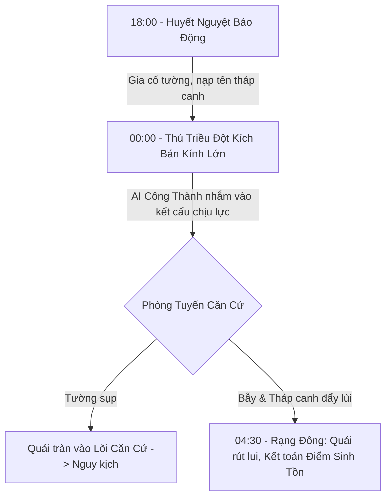
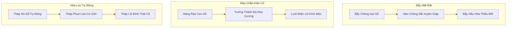

# THIẾT KẾ CHI TIẾT: THÚ TRIỀU, 4 ĐẠI BOSS, CÔNG TRÌNH PHÒNG THỦ & CÔNG THỨC TINH LUYỆN
# DỰ ÁN: LAM TINH – HOANG CỔ KÝ

---

## PHẦN 1: HỆ THỐNG DỊ THÚ & QUY LUẬT THÚ TRIỀU (BEASTIARY & RAID SYSTEM)

### 1.1. Cơ Chế Phát Động Thú Triều Đêm (Raid Mechanism)
* **18:00 (Hoàng Hôn):** Bầu trời chuyển sang màu đỏ máu (Huyết Nguyệt cảnh báo). Âm thanh tiếng hú trầm đục vọng lại từ rừng sâu. Bảng điều khiển hiển thị đồng hồ đếm ngược: `Thú triều đổ bộ sau: 00:06:00`.
* **00:00 (Nửa Đêm - Đỉnh Điểm):** Sương mù dày đặc che khuất tầm nhìn, quái vật xuất hiện đồng loạt từ rìa bản đồ, lao thẳng về hướng có ánh sáng và căn cứ của người chơi.
* **04:30 (Rạng Đông):** Ánh mặt trời đầu tiên xuất hiện. Dị thú còn sót lại bị giảm 70% sát thương, mắt bị mù lòa do ánh sáng và tháo chạy vào rừng sâu.



### 1.2. 4 Dạng Hành Vi AI Thú Triều (Siege AI Archetypes)
1. **Loài Công Phá / Húc (Siege Ram):**
   * Ưu tiên mục tiêu: Tường rào, cửa gỗ, cột chịu lực.
   * Hành vi: Tích tốc độ từ cự ly 15m rồi ủi thẳng vào kết cấu. Gây sát thương x3 lên gỗ và đá.
2. **Loài Vượt Rào / Đột Kích (Infiltrator / Jumper):**
   * Ưu tiên mục tiêu: Người chơi đang đứng trên tháp canh hoặc bên trong sân nhà.
   * Hành vi: Bỏ qua tường rào thấp (nhảy cao 3m) hoặc đào hang luồn dưới chân móng đất yếu.
3. **Loài Ăn Mòn & Khống Chế (Corrosive / Debuffer):**
   * Ưu tiên mục tiêu: Cụm bẫy rào và vị trí tụ tập đông người.
   * Hành vi: Đứng từ cự ly 8m phun axit ăn mòn vĩnh viễn giáp công trình hoặc phun tơ nhện làm chậm người chơi 60%.
4. **Loài Bầy Đàn Quấy Nhiễu (Swarmers):**
   * Ưu tiên mục tiêu: Người chơi và thú cưng thuần hóa.
   * Hành vi: Số lượng cực kỳ đông (15–30 con mỗi đợt), chạy zíc-zắc nhằm kích nổ hết bẫy chông của người chơi để mở đường cho quái to.

### 1.3. Danh Mục Dị Thú Theo Chu Kỳ Ngày

| Giai Đoạn Ngày | Loài Quái Vật | Dạng AI | Chỉ Số Cơ Bản (HP/Công/Thủ) | Nguy Cơ Chính Cho Căn Cứ |
| :--- | :--- | :--- | :--- | :--- |
| **Ngày 1 – 7** *(Làm quen)* | **Chó Sói Hoang Đêm** | Bầy đàn | HP: 120 / Dmg: 18 / Giáp: 5 | Đi theo bầy 3–5 con, rình cắn người chơi ra khỏi nhà. |
| | **Lợn Rừng Nanh Dài** | Công phá | HP: 350 / Dmg: 25 / Giáp: 15 | Húc nứt vách tường gỗ cấp 1 trong 3 cú tông. |
| **Ngày 8 – 15** *(Thú triều sơ cấp)* | **Bầy Sói Bọc Gai** | Bầy đàn | HP: 280 / Dmg: 32 / Giáp: 20 | Da bọc vảy sừng, chết sẽ nổ gai sắt cào rách người đứng gần. |
| | **Nhện Độc Đầm Lầy** | Ăn mòn | HP: 200 / Dmg: 20 (Độc) / Giáp: 10 | Phun dịch axit làm mục rỗng chân tường gỗ. |
| | **Báo Đen Rừng Già** | Vượt rào | HP: 400 / Dmg: 45 / Giáp: 18 | Nhảy tót qua tường gỗ cao 2m, ám sát người chơi. |
| **Ngày 16 – 30** *(Quái Tinh Anh)* | **Bọ Hung Thiết Giáp** | Công phá | HP: 1,200 / Dmg: 60 / Giáp: 60 | Miễn nhiễm 80% sát thương tên bắn; ủi sập tường đá nhanh chóng. |
| | **Dơi Quỷ Cổ Đại** | Vượt rào | HP: 450 / Dmg: 38 / Giáp: 15 | Bay lượn trên không, phóng luồng âm thanh làm mất thăng bằng. |
| | **Vượn Tay Dài Ném Đá** | Tầm xa | HP: 850 / Dmg: 55 / Giáp: 25 | Đứng ngoài tầm bẫy ném tảng đá lớn phá hủy tháp canh. |
| **Ngày 31+** *(Ác mộng biến dị)* | **Thằn Lằn Dung Nham** | Ăn mòn | HP: 2,500 / Dmg: 85 (Hỏa) / Giáp: 70 | Đi đến đâu thiêu rụi cây cỏ đến đó, biến tường thành biển lửa. |
| | **Mộc Ma Khát Máu** | Công phá | HP: 3,800 / Dmg: 95 / Giáp: 50 | Rễ cây đâm xuyên lòng đất phá tan lõi nhà từ bên dưới. |

---

## PHẦN 2: 4 ĐẠI BOSS THÚ TRIỀU THEO CHU KỲ (THE 4 NIGHT LORDS)

Boss xuất hiện đúng thời khắc 00:00 của các ngày cột mốc, đi kèm hiệu ứng thời tiết dị biến toàn server.

```
[Đêm 10: Thiết Giáp Cự Trĩ] ---> [Đêm 20: U Minh Xà Vương] ---> [Đêm 30: Huyết Sí Dơi Vương] ---> [Đêm 50: Hắc Nham Cự Nhân]
```

### 2.1. Boss Đêm 10: THIẾT GIÁP CỰ TRĨ (ARMORED BOAR TITAN)
* **Bối cảnh:** Vua lợn rừng khổng lồ cao 4 mét, bọc lớp vảy đá dày đặc trên đầu và lưng.
* **Chỉ số:** HP: 8,000 | Tấn công: 120 | Giáp: 50 (Giáp đầu: 90).
* **Bộ Chiêu Thức:**
  1. *Cực Tốc Đoạt Mệnh (Tông xe lửa):* Lao thẳng với tốc độ cực đại, xuyên thủng mọi hàng rào gỗ thường, gây 300 sát thương va đập.
  2. *Chấn Địa Trọng Giậm:* Dậm 2 chân trước xuống đất, làm choáng toàn bộ người chơi trong bán kính 6m trong 2 giây.
  3. *Bão Gai Lưng:* Rung lắc cơ thể, bắn ra hàng chục gai nhọn hình nón gây sát thương diện rộng.
* **Cơ Chế Điểm Yếu Chí Mạng (Weakspot Mechanics):**
  * Đầu bọc thép miễn sát thương tên bắn.
  * **Cách hạ gục:** Dụ Boss tông trúng **Bẫy Khối Đá Tảng Cương Nham**. Lực va chạm cực lớn sẽ làm Boss bị choáng 5 giây và lật ngửa bụng lên $\rightarrow$ Bụng dưới không có giáp (Nhận x3 sát thương bạo kích).
* **Vật Phẩm Rơi (Loot Table):**
  * `100%`: 01 Phôi Vũ Khí Tím (Đao Cương Lực hoặc Khiên Gai Titan).
  * `100%`: 10 Tấm Da Heo Bọc Giáp (Nâng cấp nhà gỗ lên Tier 2/3).
  * `50%`: 01 Đan Reroll Thiên Phú.
  * `15%`: Thiên phú ngộ đạo: *Kim Cang Bất Hoại Sơ Cấp*.

---

### 2.2. Boss Đêm 20: U MINH THAO THIẾT XÀ (NETHER SWAMP SERPENT)
* **Bối cảnh:** Mãng xà hai đầu khổng lồ trườn ra từ Đầm Lầy Tử Khí, mang theo sương mù độc hại làm giảm nhiệt độ môi trường xuống 0°C.
* **Chỉ số:** HP: 22,000 | Tấn công: 180 (Kèm độc rút máu) | Giáp: 45 | Kháng băng: 80%.
* **Bộ Chiêu Thức:**
  1. *Mưa Dịch Axit:* Phun 3 luồng dịch xanh lên trời, rơi xuống tạo 3 vũng axit ăn mòn 5% độ bền công trình mỗi giây.
  2. *Hàn Khí Chướng Ma:* Thổi hơi lạnh làm thân nhiệt toàn bộ người chơi tụt dốc không phanh về mức rét cóng (< 32°C).
  3. *Tảo Vĩ Lôi Đình:* Quét đuôi 360 độ, đánh sập các tháp canh tầm thấp.
* **Cơ Chế Điểm Yếu Chí Mạng:**
  * Toàn thân phủ vảy trơn trượt khó chém trúng.
  * **Cách hạ gục:** Khi Boss chuẩn bị phun mưa axit (cổ họng phình to và phát sáng xanh lam trong 2.5s), xạ thủ bắn **Tên Lửa / Ném Bình Dầu Hỏa** trúng cổ họng sẽ kích hoạt phản ứng nổ hóa học, làm đứt đầu phụ của xà vương, khóa chiêu phun độc trong 30 giây.
* **Vật Phẩm Rơi:**
  * `100%`: 01 Túi Nọc Độc Chúa (Chế tạo vũ khí ám sát phẩm chất Cam).
  * `100%`: 15 Vảy Xà Vương Chống Nước & Axit.
  * `30%`: 01 Trứng Dị Thú Mãng Xà (Ấp nở pet chiến đấu hệ độc).

---

### 2.3. Boss Đêm 30: HUYẾT SÍ HẮC DƠI VƯƠNG (BLOOD-WING BAT MONARCH)
* **Bối cảnh:** Lãnh chúa bóng đêm ngự trị trên bầu trời hoang cổ, sải cánh dài 12m, coi thường mọi hàng rào phòng thủ mặt đất.
* **Chỉ số:** HP: 45,000 | Tấn công: 250 | Giáp: 35 | Tốc độ bay: Rất nhanh.
* **Bộ Chiêu Thức:**
  1. *Hút Máu Bắt Cóc:* Lao bổ nhào từ trên không, gắp người chơi lên cao 10m rồi thả rơi tự do (gây sát thương rơi chết người).
  2. *Sóng Siêu Âm Hủy Diệt:* Phát sóng siêu âm làm vỡ kính, nứt gỗ, gây điếc và đảo ngược cụm phím di chuyển của người chơi (Confusion).
  3. *Huyết Vụ Triệu Hoán:* Hóa thành làn sương máu tàng hình, đồng thời gọi 20 con Dơi Quỷ bay vào cắn phá lõi nhà.
* **Cơ Chế Điểm Yếu Chí Mạng:**
  * Ban đêm ở trên trời là bất khả xâm phạm.
  * **Cách hạ gục:** Người chơi phải chuẩn bị sẵn **Tháp Đèn Dầu Phản Quang (Aegis Lamp)** hoặc kích hoạt **Lôi Kích Thần Mộc**. Khi dơi vương lao xuống, bật đèn chiếu thẳng vào mắt nó $\rightarrow$ Đôi mắt nhạy cảm ánh sáng bị mù tạm thời, rơi thẳng xuống đất bất động 6 giây.
* **Vật Phẩm Rơi:**
  * `100%`: Gân Cánh Dơi Cổ Đại (Nguyên liệu chế Cung Thần Săn Bắn phẩm chất Cam).
  * `100%`: 01 Trái Tim Dị Biến (Nguyên liệu cốt lõi nâng cấp Căn Cứ lên Tier 4 - Pháo Đài Hắc Thiết).
  * `10%`: Mở khóa danh hiệu toàn server: *"Kẻ Xé Rách Màn Đêm"*.

---

### 2.4. Boss Đêm 50 (World Boss Mùa Giải): HẮC NHAM SƠN NHẠC CỰ NHÂN (OBSIDIAN TITAN)
* **Bối cảnh:** Quái vật đá dung nham cổ xưa thức tỉnh từ lòng đất, cao ngang ngọn núi nhỏ, mỗi bước chân gây động đất toàn map.
* **Chỉ số:** HP: 150,000 | Tấn công: 500 (Gõ 1 đòn sập nửa căn cứ) | Giáp: 120.
* **Bộ Chiêu Thức:**
  1. *Oanh Tạc Thiên Thạch:* Bốc tảng đá dung nham ném xa 40m, nổ tung tạo biển lửa thiêu rụi căn cứ.
  2. *Địa Liệt Cuồng Triều:* Đấm tay xuống đất làm nứt toác mặt đất thành khe nứt dung nham, nuốt chửng toàn bộ bẫy chông.
  3. *Thân Thể Hóa Nham:* Tự tăng 100% giáp và phản lại 30% sát thương cận chiến.
* **Cơ Chế Điểm Yếu Chí Mạng (3 Giai Đoạn Đánh Boss):**
  * **Pha 1 (Bắn vỡ 2 Đầu Gối):** Tập trung hỏa lực tầm xa bắn nát 2 Tinh Thạch Địa Mạch ở khớp gối để cự nhân ngã quỵ xuống đất.
  * **Pha 2 (Leo lên lưng):** Lợi dụng lúc Boss quỳ, người chơi trèo lên các mấu đá trên lưng chém vào Lõi Năng Lượng sau gáy.
  * **Pha 3 (Cuồng bạo tuyệt vọng):** Dưới 15% máu, toàn thân Boss bốc cháy $\rightarrow$ Người chơi phải dùng Nước Suối Băng Đầm Lầy tạt vào để làm nguội giáp mới kết liễu được.
* **Vật Phẩm Rơi (Toàn Server Vinh Danh):**
  * `100%`: **Bản Thiết Kế Động Phủ Hư Không** (Nâng cấp Căn Cứ lên Tier 5 Thần Thoại).
  * `100%`: 03 Phôi Trang Bị Thần Thoại (Đỏ).
  * `100%`: 01 Hòn Đá Hỗn Độn Nguyên Bản (Dùng chế tạo cổng dịch chuyển liên minh).

---

## PHẦN 3: HỆ THỐNG CÔNG TRÌNH PHÒNG THỦ & BẪY RÀO (DEFENSE ARSENAL)



### 3.1. Bảng Thông Số Chi Tiết Bẫy & Công Trình Phòng Thủ

| Tên Công Trình | Nguyên Liệu Chế Tạo | Độ Bền (HP) | Sát Thương / Tác Dụng | Cơ Chế Kích Hoạt |
| :--- | :--- | :--- | :--- | :--- |
| **Bẫy Chông Gai Gỗ** | 20 Gỗ thường + 5 Dây leo | 3 lần đạp | 45 sát thương; làm chậm 30% trong 2s. | Quái dẫm trúng chông bật lên. |
| **Hàng Rào Cọc Nhọn** | 50 Gỗ cứng + 10 Dây gân | 800 HP | Phản lại 20% sát thương quái húc vào; cản bước quái nhỏ. | Kết cấu cản đường tĩnh. |
| **Hào Chông Sắt Xuyên Giáp**| 30 Thỏi Sắt + 20 Đá cuội | 10 lần đạp | 120 sát thương; bỏ qua 50% giáp; gây Chảy Máu rút máu 5s. | Bẫy âm sàn dưới mặt đất. |
| **Bẫy Dầu Hỏa Bốc Cháy** | 10 Nhựa Cây + 5 Dầu Mỡ Thú | 1 lần nổ | Nổ diện rộng 3m; đốt cháy 60 dmg/giây trong 6 giây. | Kích nổ khi quái đạp hoặc bị bắn tên lửa. |
| **Tháp Nỏ Canh Gác (Tier 2)**| 150 Gỗ Thiết Mộc + 40 Sắt | 2,500 HP | Tự bắn tên tầm 15m; 40 dmg/mũi; tốc độ 1 phát/giây. | Tự động khóa quái trong tầm, cần nạp hộp tên. |
| **Đèn Dầu Xua Dã Thú** | 30 Hắc Nham + 10 Tinh Thạch | 1,500 HP | Chiếu luồng sáng cực mạnh; giảm 40% tốc chạy & -25% giáp quái bóng đêm. | Tiêu hao Dầu Thú / Than Đá để duy trì nguồn sáng. |
| **Lưới Điện Lôi Kích (Tier 4)**| 50 Gỗ Lôi Kích + 30 Hắc Thiết | 12,000 HP | Giật điện 150 dmg lên mọi quái chạm vào; làm choáng 1.5s (giật lan 3 con). | Tự phục hồi điện sau mỗi 3 giây. |
| **Tháp Lôi Đình Thái Cổ (Tier 5)**| 1 Lõi Thú Vương + 50 Thần Kim | 35,000 HP | Phóng tia sét hủy diệt 450 dmg tầm 25m; tiêu diệt quái bay trong tích tắc. | Năng lượng vĩnh cửu từ Lõi Boss. |

---

## PHẦN 4: BẢNG CÔNG THỨC TINH LUYỆN TỔ HỢP CHI TIẾT (SYNERGY RECIPES)

Cơ chế chế tạo trên **Bàn Tinh Luyện Tổ Hợp**: Người chơi kéo thanh trượt cân bằng tỷ lệ % giữa 3 trụ cột (Gỗ - Đá - Sắt) và đưa vào đúng Phụ Gia Tinh Luyện. Nếu căn đúng nhiệt độ lò rèn (Minigame bấm phím đúng vạch vàng), trang bị chắc chắn đạt phẩm chất cao nhất.

```
[ GỖ % ] + [ ĐÁ % ] + [ SẮT % ] + [ PHỤ GIA ĐẶC CHỦNG ] ---> PHẨM CẤP VŨ KHÍ
```

### 4.1. Công Thức Chế Tạo 7 Dòng Vũ Khí Cốt Lõi

| Vũ Khí Mục Tiêu | Tỷ Lệ Tổ Hợp Chuẩn | Phụ Gia Bắt Buộc | Yêu Cầu Minigame Rèn | Thuộc Tính Khi Đạt Cực Phẩm (Tím) / Cam |
| :--- | :--- | :--- | :--- | :--- |
| **Kiếm Sắt Cương Lực** | 65% Sắt + 20% Gỗ Thiết Mộc + 15% Đá Cứng | 1 Huyết Sói Cổ Đại | Giữ nhiệt độ lò rèn ở mức 850°C trong 4 nhịp búa | Sát thương: 55–68; +20% Xuyên Giáp; Hiệu ứng Chém Sâu (Chảy máu 8 dmg/s). |
| **Trọng Kiếm Phá Sơn** | 50% Hắc Thiết + 40% Đá Cương Nham + 10% Gỗ | 1 Xương Thú Tinh Anh | Gõ búa nhịp chậm, dứt khoát 3 lần liên tiếp | Sát thương: 110–135; Tốc đánh chậm; Chém trúng phá vỡ 100% thế thủ của quái to. |
| **Trường Thương Xuyên Vân**| 35% Sắt + 15% Đá Nhọn + 50% Gỗ Linh Liễu | 1 Gân Thú Đàn Hồi | Tôi mũi thương bằng dầu lạnh sau khi đập | Tầm đánh 3.8m; Tốc độ đâm cực nhanh; Đâm xuyên qua 2 lớp hàng rào bảo vệ. |
| **Song Đao Hắc Ám** | 70% Sắt Tôi + 10% Gỗ Mun + 20% Hắc Nham | 1 Túi Độc Nhện Chúa | Mài lưỡi dao trên đá mài mịn 5 vòng | Sát thương: 28–34 x 2; Tốc đánh siêu tốc; Mỗi nhát chém cộng dồn 1 tầng Độc tố. |
| **Cung Thần Phong Lôi** | 75% Gỗ Lôi Kích + 15% Gân Dã Thú + 10% Sắt | 1 Tinh Thạch Gió Bão | Uốn cong thân cung trên hơi nước sôi | Tầm bắn 28m; Mũi tên bắn ra tự bọc tia sét, giật lan sang 3 quái vật lân cận. |
| **Nỏ Săn Hắc Thiết** | 60% Hắc Thiết + 30% Gỗ Cứng + 10% Đá Mài | 1 Lò Xo Cơ Giới | Lắp ráp các bánh răng ăn khớp 100% | Sát thương: 180–220; Tỉ lệ bạo kích +35%; Bắn xuyên qua 3 quái thẳng hàng. |
| **Pháp Trượng Liệt Diễm**| 60% Gỗ Trầm Hương + 30% Hắc Nham + 10% Kim Loại| 1 Tinh Hạch Lửa Đỏ | Tụng chú trong 3 giây khi rót dung nham | Gọi mưa thiên thạch nhỏ thiêu rụi vùng 5m; sưởi ấm thân nhiệt đồng minh +2°C. |

---

### 4.2. Công Thức Chế Tạo 3 Bộ Giáp Sinh Tồn

| Bộ Trang Phục / Giáp | Tỷ Lệ Tổ Hợp Chuẩn | Phụ Gia Kèm Theo | Đặc Tính Sinh Tồn Độc Nhất |
| :--- | :--- | :--- | :--- |
| **Áo Lông Sói Tuyết** | 70% Da Lông Dã Thú + 20% Dây Leo + 10% Gỗ | Mỡ gấu bôi chống thấm nước | **Kháng lạnh tuyệt đối:** Miễn nhiễm hạ thân nhiệt khi đêm xuống hoặc bão tuyết. |
| **Chiến Giáp Cương Nham**| 60% Đá Hoa Cương + 25% Da Bò + 15% Sắt | Keo nhựa cây kết dính phiến đá | Giảm 35% sát thương va đập từ thú húc; kháng chấn động làm choáng. |
| **Giáp Trụ Hắc Thiết** | 65% Thỏi Sắt Đen + 20% Đá Cứng + 15% Vải Lót | Dầu khoáng chống gỉ | Giáp vật lý cực đại (+45 Giáp); giảm 30% sát thương từ móng vuốt và răng nanh. |

---

### 4.3. Công Thức Bộ Dụng Cụ Khai Thác Cực Phẩm

* **Rìu Phạt Mộc Cực Phẩm:** `50% Sắt + 30% Gỗ Cứng + 20% Đá Mài Nhọn` $\rightarrow$ Đốn đổ cây cổ thụ ngàn năm chỉ sau 4 nhát rìu; tăng 20% sản lượng gỗ lõi rơi ra.
* **Cuốc Khai Sơn Cực Phẩm:** `60% Hắc Thiết + 30% Cương Nham + 10% Gỗ Cán` $\rightarrow$ Đào được quặng sâu và đá quý không bị mẻ đầu cuốc; 10% đào trúng Hắc Nham Núi Lửa.
* **Búa Sửa Chữa Thần Tốc:** `40% Gỗ Thiết Mộc + 40% Đá Cương Nham + 20% Sắt` $\rightarrow$ Mỗi cú gõ hồi phục 250 HP cho tường thành (gấp 2.5 lần búa thường); tốn ít hơn 30% nguyên liệu vá nhà.
